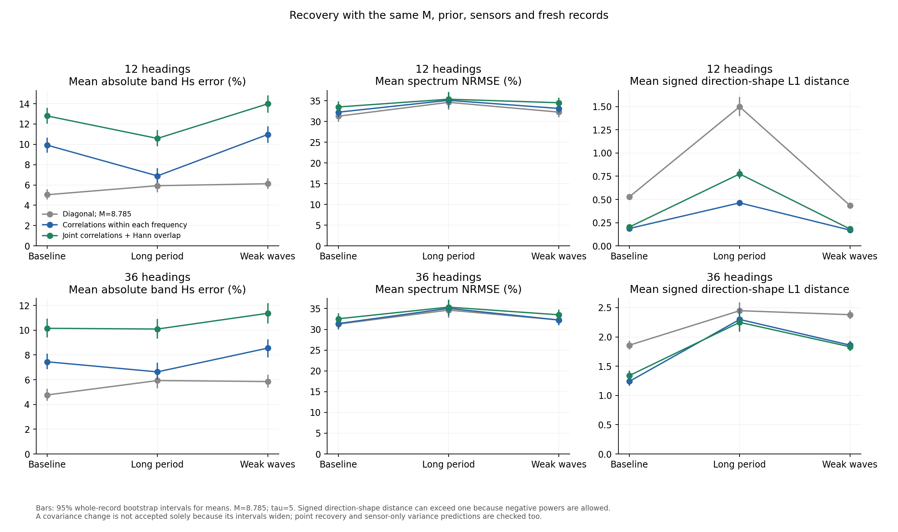
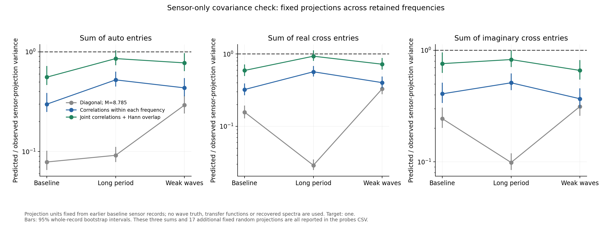
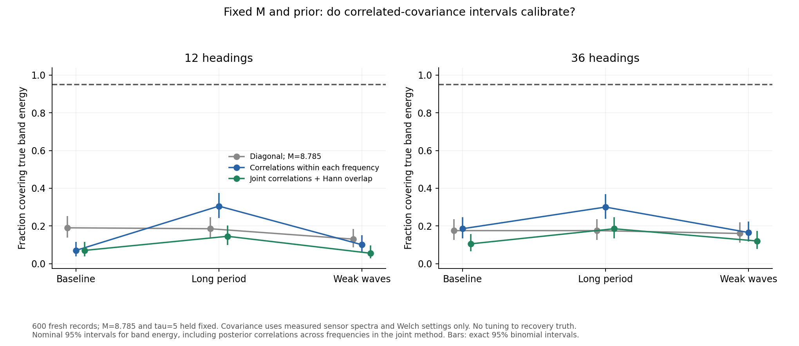
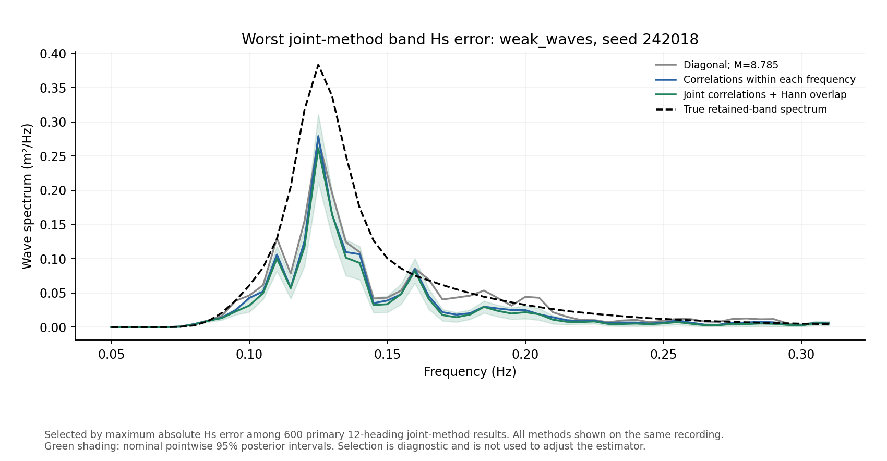

# Correlated covariance with M and the prior frozen

**Finding: this first correlated plug-in covariance is not ready to merge.**
It improves important sensor-level covariance predictions and directional
shape, but introduces substantial downward wave-height bias. With M and tau
fixed, the joint method's mean absolute Hs errors are **12.80%, 10.58% and
13.99%**, versus **5.04%, 5.93% and 6.12%** for the corrected diagonal method
on exactly the same fresh records. Its nominal 95% band-energy coverage is
only **7.0%, 14.5% and 5.5%**. No parameter was retuned to rescue this result.



This tests the next candidate after [the failed diagonal inverse uncertainty
check](inverse_recovery.md). It preserves the calibrated M = 8.785033150237455
and tau = 5. Production code, main, the report and the Drive data remain
unchanged. The outcome must be reviewed before adoption.

## What this experiment changes

Each individual spectral variance remains the corrected fixed-M estimate.
Only the correlations between estimation errors change. Every method uses
the same data-derived prior scale from the original inverse. There is no
positivity constraint, new smoothness prior or inverse-based M selection.

Three prespecified methods are compared on the same recordings:

1. Diagonal covariance, with the previously corrected marginal variances.
2. Correlated entries at the same frequency, using full Wishart structure.
3. Joint correlations across entries and frequencies, using the same
   Wishart structure and the Hann-window/overlap calculation.

The third method changes the joint Gaussian likelihood and solves all retained
frequencies together. It is not simply a wider error bar attached to the old
point estimate. The posterior covariance between frequencies is retained in
the band-energy uncertainty.

## Sensor-only construction

The covariance estimator receives measured sensor spectra, M and the Welch
settings. It never receives the generating wave spectrum, phases, true sea
parameters, response matrix A or recovered x. A is used only by the subsequent
inverse. The estimator computes a new covariance for each recording using
the same fixed rule; it does not look up a matrix by sea condition.

First normalise the measured 9-by-9 sensor spectral matrix to unit diagonal,
giving complex sensor coherence matrix G. With L = M - 1, use

$$
\lambda=\operatorname{clip}_{[0,1]}
\frac{\sum_{c\ne k}(L-|G_{ck}|^2)/(L^2-1)}
     {\sum_{c\ne k}|G_{ck}|^2},\qquad
G_\lambda=(1-\lambda)G+\lambda I.
$$

If the denominator is zero, lambda is one. The numerator uses the complex
Wishart moment estimate of squared estimation error. This is a sensor-only
quadratic-risk shrinkage rule, motivated by the diagonal-target framework in
[Schafer and Strimmer (2005)](https://strimmerlab.github.io/publications/journals/shrinkcov2005.pdf).
Its use of estimated normalising diagonals is an approximation; it is not
claimed to be an exact optimal complex-coherence estimator. No intensity is
chosen by inverse recovery or nominal-coverage matching.

For each frequency, form the principal Hermitian square root of G_lambda.
Transform an orthonormal Hermitian basis B through that root and stack the
result's real/imaginary entries in the existing 81-entry order. The resulting
factor T obeys T T-transpose = the full real-stacked Wishart covariance for
one effective average. Normalise each row and multiply by the corresponding
fixed-M standard deviation D:

$$
F_f=\operatorname{diag}
\left(\frac{D_{f,a}}{\sqrt{(T_fT_f^T)_{aa}}}\right)T_f.
$$

Thus diag(F_f F_f-transpose) is exactly the previously calibrated marginal
variance vector. M is not applied a second time. Shrinkage keeps the sensor
matrix positive definite despite the small segment count. Computation first
normalises sensor units, avoiding numerical problems from mixing pressure
and angular spectra.

For frequency correlations, compute the squared Fourier transforms of the
overlapping Hann-window products, summed over segment pairs. Divide by the
zero-lag value to obtain a unit-diagonal Toeplitz matrix R. For eight
200-second segments in 900 usable seconds, its first off-diagonal
correlations are approximately 0.45724, 0.03808 and 0.00134. The mean row sum
across the 53 retained bins is 1.9731. This is a window/overlap calculation,
not an empirically selected inflation factor.

The joint covariance blocks are

$$
\Sigma_{fg}=R_{fg} F_f F_g^T.
$$

This factor construction guarantees a positive-definite structured model.
It assumes locally flat proper-Gaussian Fourier fluctuations and aligns
cross-frequency fluctuations through the principal sensor spectral roots.
It is an approximation for coloured, rapidly varying, nonlinear or drifting
sensor signals, and needs validation. Detrending and finite positive-frequency
pseudocovariance terms are not explicitly included in the window model.
Those limits are not hidden by retuning M.

## Validation design

There are 600 additional native-duration simulations: baseline seeds
240000--240199, long-period 241000--241199 and weak-wave 242000--242199.
These do not overlap the prior M, covariance-diagnostic or inverse studies.
The generator, hull, 6400-component wave grid, 40-frequency BEM grid, sensor
errors and processing remain those of the previous studies. All three
methods use both 12 and 36 inverse headings: 3600 inversions in total.

Before inverse assessment, compare predicted and repeat-record variance for
20 fixed sensor-only projections. Three sum standardised auto, real-cross
and imaginary-cross entries across frequencies; 17 use fixed random
coefficients repeated across frequencies. Their units are fixed from earlier
baseline sensor records 207000--207199. These probes contain no A, wave
truth or inverse output. They are validation directions, not fitted targets.

Then assess retained-band Hs, frequency-spectrum NRMSE, circular mean
direction, full signed directional-shape distance, negative power, and
coverage of band energy, frequency power and integrated active directions.
The exact joint functional covariance is used for the joint method; summing
only per-frequency variances would repeat the original error. Pointwise
coverage of every x bin is not computed in this study because the posterior
is solved for the named functionals without materialising its full inverse.

The covariance code and rules were frozen before new record generation.
Known complex-Gaussian covariance, Hann white-noise correlations, physical-unit
invariance, exact preservation of diagonal variances, explicit dense joint
posterior agreement and the old diagonal special case are tested. Native
truth is constructed for scoring only after every inverse for that record
has finished. No estimator parameter is adjusted using these validation
outcomes.

## Fresh results and their limits

All 600 fresh recordings completed, with 3600 finite inversions and no removed
runs. The full-frequency model improves the sensor-only sum projections:

- Baseline auto/real/imaginary sum variance ratios become **0.557, 0.592 and
  0.760**, versus diagonal ratios 0.079, 0.157 and 0.244. Their 95% intervals
  still exclude one: important variance remains underestimated.
- Long-period ratios become **0.855, 0.930 and 0.826**, versus 0.092, 0.029
  and 0.099. The estimates are much closer, although they do not establish
  equivalence within 10%.
- Weak-wave ratios become **0.774, 0.721 and 0.660**, versus 0.292, 0.329 and
  0.313. Their intervals still indicate underestimation.

Across all 20 probes, joint-method median ratios are 0.920, 1.141 and 0.896;
11, 10 and 14 of 20 pointwise intervals include one. Only 16/20 long-period
point estimates are within a factor of two. The probes are correlated and
the intervals are not simultaneous; an acceptable median cannot certify
every linear combination. The theoretical structure is an improvement in
some sensor directions, not a validated covariance estimator.



For the primary 12-heading inverse, mean signed Hs biases are **-12.69%,
-9.61% and -13.92%** for the joint method, versus -2.93%, +0.25% and -3.56%
for the corrected diagonal method. Joint absolute-error bootstrap intervals
are 12.02--13.61%, 9.81--11.42% and 13.12--14.81%. The degradation is large.
Frequency-spectrum NRMSE also rises, from 31.26%, 34.61% and 32.25% to
33.49%, 35.36% and 34.51%.

The within-frequency-only method has intermediate absolute Hs errors of
9.92%, 6.89% and 10.97%. Adding correlations is not automatically an inverse
improvement when the covariance itself is a noisy data-dependent estimate.

Some directional quantities improve. Signed directional-shape L1 distance
falls from 0.529, 1.497 and 0.436 to 0.204, 0.775 and 0.182; negative power
falls from 34.2%, 44.6% and 34.3% to 19.1%, 36.6% and 20.6% of absolute
estimated power. These gains do not outweigh the height bias and failed
uncertainty calibration. The 36-heading sensitivity has the same overall
failure: joint mean absolute Hs errors are 10.15%, 10.10% and 11.37%.

Nominal 95% band-energy coverage for the primary joint method is:

- Baseline: **14/200 = 7.0%**, exact interval **3.9--11.5%**.
- Long period: **29/200 = 14.5%**, interval **9.9--20.2%**.
- Weak waves: **11/200 = 5.5%**, interval **2.8--9.6%**.

Intervals widened, but the estimate moved down as well, so coverage did not
recover. The 36-heading method also remains far below nominal coverage.





## Diagnostic: dependence on the same noisy recording

After this failed validation, an additional diagnostic exchanges covariance
estimates between pairs of baseline recordings, 100 seeds apart. Each of the
200 recordings appears once as recipient and once as donor, so the set of
covariance matrices is unchanged. Only its pairing with the measured data
changes. Recipient prior scales, M, tau, operators and covariance rules are
unchanged. This is not another covariance candidate selected by inverse truth.

For 12 headings, moving covariance to a different recording changes:

- Within-frequency mean signed Hs bias: **-9.58% to -2.91%**; absolute error
  **9.92% to 5.01%**; coverage **7% to 26%**.
- Joint mean signed bias: **-12.69% to -3.09%**; absolute error
  **12.80% to 5.12%**; coverage **7% to 33%**.

For the joint method the bias change is +9.60 percentage points, with a
95% interval of +9.33 to +9.89. The interval resamples 100 reciprocal pairs,
not 200 falsely independent recipients. This is strong conditional evidence
that using the same fluctuations to estimate both the spectrum and its
covariance contributes substantially to the downward bias.

The donor experiment is **post-validation diagnosis, not a deployable
covariance rule or fresh validation**. It uses repeated recordings under the
same simulated baseline condition; it does not show that an appropriate
independent covariance is available for a changing real sea. Coverage remains
bad even with the donor covariance. No proposed fix is validated by this
exchange, and no generating spectrum or phases are passed to the estimator.

The next bounded investigation should estimate covariance from independent
or suitably pooled sensor information, first checking sensor-level covariance
predictions and then using fresh inverse validation. M and the prior can
remain fixed for that comparison. Repeatedly changing M, a shrinkage intensity
or the prior to match recovery truth would not establish a defensible fix.

## Verification and reproducibility

All 30 tests pass, including six new checks of the correlated construction
and joint uncertainty propagation. Controlled algebraic fixtures are tests,
not recovery evidence. Frozen source hashes, the 600-record aggregate hash,
protocol, per-record results and paired bootstrap summaries are saved.
The covariance estimator did not receive A, recovered x or wave truth.

To reproduce after the prior M calibration data exist:

```sh
python WM/check_correlated_covariance.py --generate --workers 2
python WM/check_correlated_covariance.py --workers 2
python WM/analyse_correlated_covariance.py
python WM/diagnose_same_record_covariance.py
python -m unittest discover -s WM -p 'test_*.py' -v
```

## Later merge, regeneration and report handoff

These requirements should travel with any eventual implementation:

- Merge only a validated covariance rule. Review sensor-level predictions,
  inverse errors, negative power, failed runs and uncertainty coverage
  together. Better covariance or wider intervals alone are not acceptance.
  Keep unsupported cases and inconclusive intervals visible.
- Retain M's meaning as the implemented marginal-variance denominator, not a
  literal Welch-segment count. Its equivalent Wishart count is M - 1 under
  the finite-average correction. Keep tau fixed during this comparison.
- The existing shared generator/inverse physics is unchanged. Sensor-only
  calibration avoids additional wave-truth leakage but does not establish
  physical independence or real-vessel validity. Fresh seeds are held-out
  records, not independent physics.
- Before regenerating Drive data, separate the wave-component count from
  the BEM response-grid count: the original n_freq parameter couples them.
  Do not request 6400 BEM frequencies. Promote accelerated harmonic synthesis
  only after parity checks across relevant conditions, preserving hull
  integration, controller, sensor errors and preprocessing.
- New data should record source/version hashes, hull and sensor geometry,
  wave-grid placement/count, BEM count, random seeds, recording duration and
  processing settings. Do not retroactively assign this calibration to the
  historical Drive archive without verifying its provenance.
- Report edits remain pending. In Section 2.2.2 retain a clear definition of
  the recording-derived estimate Shat and the 81-entry stacking. In 2.2.3
  explain the tested covariance and its approximation limits concisely;
  distinguish it from the forward model's expected spectrum. Include the
  actual held-out result, rather than claiming a full Wishart likelihood
  when the implementation is a Gaussian approximation with Wishart moments.
  Preserve the agreed prose and use the report's section/subsection style.
  The report's main method must match the code and data actually adopted;
  rejected research candidates belong in a limitations/validation discussion,
  not as claims that a corrected final method has been implemented.
- If the joint method is eventually adopted, the report must stop claiming
  frequencies are solved independently. Define the joint data/parameter
  vectors across frequencies, the block-diagonal forward operator, and the
  prior scales s_f explicitly. Reusing the old per-frequency notation while
  changing the implementation would misdescribe the method.
- Keep negative power and directional identifiability as explicit separate
  issues. Do not silently add positivity or select a prior by these tests.

Raw simulation and fit caches stay ignored. Research source, protocol,
aggregate evidence and plots belong on the exploration branch. There is no
main merge, Drive regeneration or report edit in this experiment.
