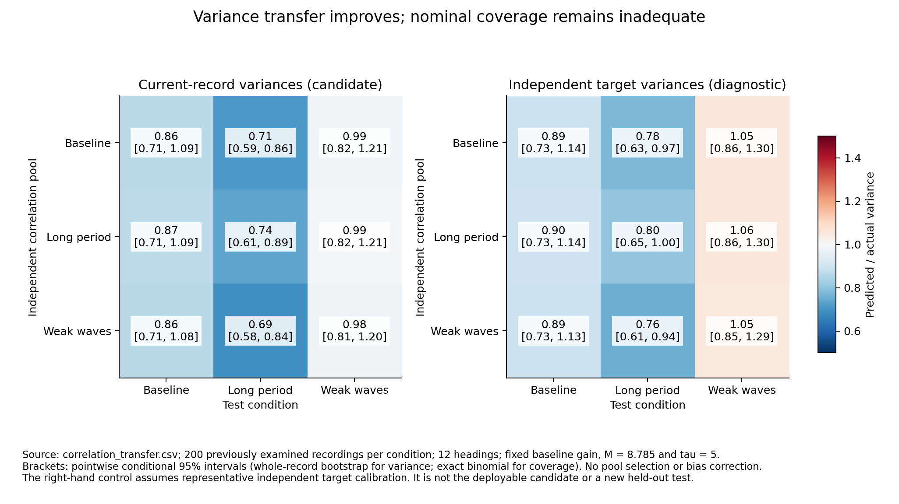
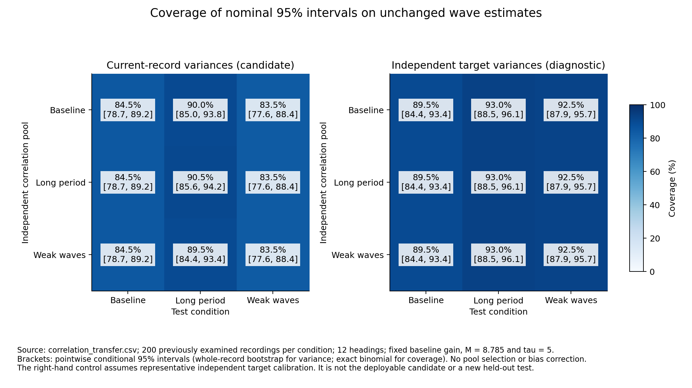

# Transferring correlations while estimating current variance levels

**Result: rescaling removes the earlier catastrophic transfer errors, but the candidate still fails the uncertainty acceptance test.** With one baseline correlation pool fixed for all conditions, predicted/actual energy variance is **0.864, 0.714 and 0.986**. Nominal 95% interval coverage is only **84.5%, 90.0% and 83.5%**. Every primary coverage confidence interval lies below 95%; long-period variance is also demonstrably underestimated.

M remains **8.785033150237455**, tau remains **5**, and all saved wave estimates are unchanged. No simulated data, inverse fit, bias correction, pool selector, empirical inflation or new correlation fit is introduced. The report, main and Drive data are unchanged. This is retrospective development evidence, not fresh final validation.

## Why this was the next test

The [previous fixed-estimator comparison](fixed_estimator_scatter.md) showed that representative pooled covariance can describe energy scatter reasonably closely. Transferring the entire absolute covariance between sea conditions failed, sometimes by factors exceeding 100. That test changed two things together: marginal variance levels and correlation structure.

The present comparison isolates them. Further M sweeps would rescale already-calibrated marginal variances without identifying the transfer failure. Changing the forward mean or point estimator would change the quantity whose uncertainty we are trying to describe. More seeds alone would narrow the uncertainty on the existing failure without separating its mechanisms.

This is therefore the most direct next diagnostic supported by existing evidence, not a claim that every alternative statistical method has been excluded. Before computing the new results, we fixed the candidate, primary baseline pool/gain, controls, all-pairs comparisons and the existing ±10% variance-equivalence criterion. Since the records were already examined, this is not prospective preregistration or untouched validation.

## Candidate and controls

Each previous pooled factor F_f contains absolute marginal scales and correlations. Let d_f be its row norms. For each new measured sensor spectrum, calculate the existing corrected marginal variances v_f at the same M, then use

    F_new,f = diag(sqrt(v_f)) diag(1/d_f) F_f.

This preserves the donor correlation structure and replaces only its variance levels. Keep the existing Hann frequency kernel W, so the joint covariance blocks remain

    Sigma_fg = W_fg F_new,f F_new,g^T.

The construction is positive definite whenever the original structured covariance is, and has exactly the target-record marginal variances. No generating wave spectrum, phases or true sea-state parameter enters it. It does not assert that real spectral errors follow this covariance exactly.

Propagate each covariance through the **same saved reference gains** from the previous study. The actual point estimates and their per-record priors are read from the existing corrected-diagonal score file; no inverse is recomputed. Primary analysis uses 12 headings, the baseline-reference gain, and the baseline correlation pool for every test condition. Other pools, all three gains and 36 headings remain sensitivity checks, never an oracle selection rule.

Controls:

- The previous absolute pooled covariance, unchanged.
- Within-frequency-only propagation, to isolate frequency coupling.
- The same donor correlations rescaled to **independent representative target-pool marginal variances**. This idealised control uses the previously collected pool matching the target condition, solely to diagnose current-record scale estimation. It is not available automatically for an unknown sea, and is not the deployable candidate.

The 600 test records are the same three sets of 200 from the pooled study, independent of the three 200-record calibration pools. There are 216 covariance comparisons across methods, couplings, references, headings, pools and conditions; they are not 216 independent experiments.

## Variance prediction



With baseline correlations fixed, candidate predicted variance divided by the actual unchanged estimator's repeat-record variance is:

- Baseline: **0.864**, 95% whole-record bootstrap interval **0.709–1.086**.
- Long period: **0.714**, interval **0.593–0.860**.
- Weak waves: **0.986**, interval **0.817–1.209**.

None establishes equivalence within ±10%. Long-period underestimation is resolved; the other two are statistically compatible with one but too imprecise for a strong calibration claim. Variances, not standard deviations, are being compared.

Changing the donor correlation pool has a small effect within these tested conditions. The three donor-pool point ratios span **0.861–0.867** at baseline, **0.695–0.737** for long period, and **0.983–0.989** for weak waves. Thus absolute variance transfer explained much of the earlier extreme failure; there is no need to select a favourable donor to obtain this improvement. This limited transfer result does not generalise to other directions, depths or hulls.

For comparison, transferring the baseline pool's absolute covariance gave ratios **0.894, 0.441 and 136.962**. The candidate therefore greatly improves weak-wave transfer and improves long-period transfer, but its latter ratio remains too low. On same-condition comparisons, there is no uniform improvement: the long-period matched pool deteriorates from 0.802 to 0.737 when its fixed scales are replaced by current-record estimates.

The ideal independent target-scale control, retaining baseline donor correlations, gives **0.894 (0.729–1.138), 0.776 (0.631–0.968), and 1.053 (0.856–1.299)**. More representative and stable scales help, but do not establish a complete fix; the long-period point prediction is still low. These control intervals condition on the fixed target calibration pool. Small changes in interval endpoints relative to earlier studies also reflect new bootstrap resampling, not changes in the original point values.

The 36-heading baseline-pool sensitivity gives candidate ratios **0.862, 0.713 and 0.991**, supporting the same conclusion. All within-frequency results and other references are saved in [the complete comparison CSV](correlation_transfer.csv).

## Coverage and unchanged recovery



Primary candidate nominal 95% coverage is:

- Baseline: **169/200 = 84.5%**, exact 95% interval **78.7–89.2%**.
- Long period: **180/200 = 90.0%**, interval **85.0–93.8%**.
- Weak waves: **167/200 = 83.5%**, interval **77.6–88.4%**.

All three intervals exclude 95%. This is a clear reason to withhold a calibrated-95%-interval claim. It remains far better than the saved diagonal posterior's 21%, 11.5% and 19%, but improvement alone is not acceptance.

The ideal independent target-scale control gives **89.5%, 93.0% and 92.5%**, respectively. In particular, almost correct *average* variance in weak waves does not give correct coverage with record-dependent intervals. The error distribution, systematic bias and association between the estimate and its uncertainty also matter.

Candidate mean full Hs interval widths are **22.30%, 27.06% and 22.29%** of true band Hs. These are monotone transformations of Gaussian energy intervals, with negative lower energy bounds clipped at zero; they are not Gaussian Hs intervals. No interval width is tuned to truth. Hs/Tp/direction estimates, errors, negative powers and biases are exactly those saved previously. The corresponding energy biases remain approximately −6.14%, +0.27% and −6.37%.

## Post-test diagnostic: does using the same recording for the scale matter?

After observing the coverage failure, we exchanged the candidate variances between records 100 seeds apart within each condition. Each record donates and receives once. This leaves the variance distribution and its average unchanged and does not move any point estimate. It is a mechanism diagnostic under repeated stationary conditions, not a new deployable rule or independent validation.

On 12 headings, coverage changes from **84.5% to 88.0%**, **90.0% to 89.5%**, and **83.5% to 87.0%**. Bootstrapping the 100 reciprocal pairs, rather than pretending all recipients are independent, gives change intervals of **+0.5 to +6.5**, **−5.0 to +4.5**, and **−0.5 to +7.5 percentage points**. Only the baseline primary change is resolved. The 36-heading sensitivity is also retained.

The estimated energy and its predicted standard deviation have correlations about **0.946–0.959**. That association alone does not establish causation; the exchange supports a contribution to baseline undercoverage. It does not establish that scale dependence explains everything. Neither the exchange nor the ideal independent-scale control restores calibrated coverage across conditions. See [the donor diagnostic](correlation_scale_dependence.csv).

## Confidence and decision

**Supported:** separating variance levels from correlations greatly reduces the observed cross-condition transfer failure. It is possible to improve uncertainty assessment without changing wave estimates. No new wave-truth calibration or inverse crime was introduced into the candidate.

**Rejected as a finished uncertainty rule:** the current candidate's long-period variance prediction is too small, all primary nominal-95% coverage intervals are below 95%, and no variance interval meets the ±10% criterion. M should not be retuned to make these intervals pass; its sensor-level calibration addresses a different question.

**Limits:** all data were previously inspected and share the existing simulator physics. Bootstrap intervals resample whole test records and are conditional on the frozen M, gain and correlation pools; they do not integrate calibration-pool or gain-estimation uncertainty. Coverage intervals are likewise conditional. The many intervals are pointwise, not simultaneous guarantees. A new independent data set is required after any final method selection, and real-vessel validity is untested.

The next plausible work is **a focused analysis of the remaining interval failure**, separating unchanged mean bias from finite-record scale estimation and missing variance. It should not begin by adding another scalar correction. Independent, locally representative scale estimation may be useful, but the ideal control here already shows it will not solve everything. Any operational version would need a stationarity/availability argument, not a true-condition lookup. A finite-sample interval treatment or independently justified model-discrepancy treatment might then be warranted; neither is demonstrated by this test. Further correlation-pool searches or a new M(f) are not supported by these results.

For the report, this investigation strengthens the conditional justification of calibrated marginal variances and identifies the remaining uncertainty limitations. It does not require us to pretend that a final posterior has been validated. No report or production change is made here.

## Reproducibility

The primary protocol was frozen before computing candidate results. Source, prior-study input and score hashes were checked; all 1,200 calibration/test input hashes from the previous study matched. The saved gains and projected outputs were cross-checked against the recorded sensor vectors. The source score file is unchanged. Rescaling tests verify exact marginal preservation, positive definiteness, correlation preservation, agreement with dense covariance propagation, physical-unit invariance and rejection of invalid scales. A separate test checks that the donor diagnostic preserves point estimates and does not automatically improve deliberately constructed examples. All **51 tests pass**.

```sh
python WM/check_correlation_transfer.py
python WM/diagnose_scale_dependence.py
python WM/plot_correlation_transfer.py
python -m unittest discover -s WM -p 'test_*.py' -v
```

Existing pooled-study recordings and the fixed-estimator reference cache are required; no generator is invoked. Per-record projected variances remain in ignored `variance_output/correlation_transfer`. Source, protocols, aggregate CSVs, plots and diagnostics are on the research branch. The primary protocol predates the explicitly post-test donor diagnostic. Main, all five production source files and all 18 frozen report files remain unchanged.
