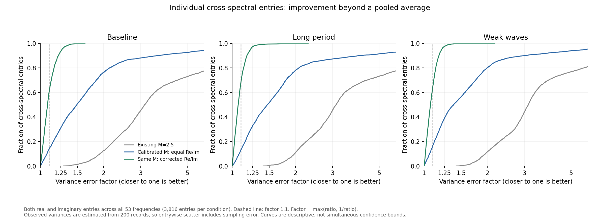
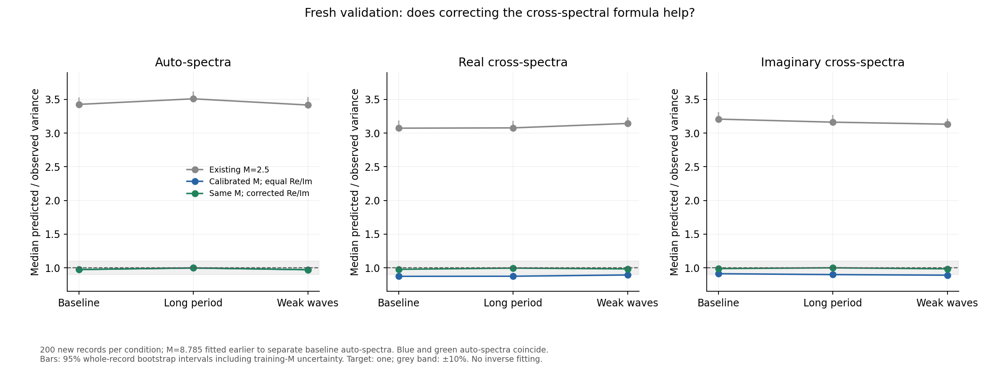

# Checking the cross-spectral variance approximation

The corrected formula substantially improves cross-spectral calibration on
**600 fresh records**, using the previous **M = 8.785** unchanged. Median
entrywise variance error factors fall from **1.38--1.49 to 1.07--1.08** across
the three held-out conditions. This supports one constant M with the corrected
formula for the tested 6400-component generator and recording settings.
It does not establish that every frequency or inverse uncertainty is correct.



This follows the [native-duration M calibration](m_calibration.md). It tests
one correction to the variance formula, with the existing baseline-auto fit
held fixed. Production code, M = 2.5, tau = 5, the report and Drive data are
unchanged. There is no inverse solve in this experiment.

## What is being corrected

The current code gives the real and imaginary parts of each cross-spectrum
the same variance. Correlated channels need not have equal variability in
these two components. The standard single-cross-spectrum expressions include
a phase-dependent term: see [Ingram (2019), section 2.3, equation 13](https://arxiv.org/html/1909.01385v1#S2.SS3).
We test marginal variances, not independence between different entries.

Let C be the underlying noise-inclusive sensor spectral matrix, and let
Shat be its estimate from one finite recording. C is not the inverse model's
noise-free prediction. Under a complex Wishart approximation with L effective
averages, put A = Ccc Ckk and z = Cck. Then

$$
\operatorname{Var}(\Re\widehat S_{ck})
 =\frac{A+\Re(z^2)}{2L},\qquad
\operatorname{Var}(\Im\widehat S_{ck})
 =\frac{A-\Re(z^2)}{2L}.
$$

For auto-spectra, the variance is Ccc squared divided by L. The cross term
can increase one component's variance and decrease the other's. Changing a
single M cannot reproduce that difference.

## Why plugging in Shat needs care

The fitted M = 8.785033 is the denominator of the current estimated-auto
formula, Shat_cc squared / M. It is not a literal count of independent Welch
segments. Under the Wishart approximation,

$$
E[\widehat S_{cc}^{\,2}]=(1+1/L)C_{cc}^{\,2}.
$$

Therefore an unbiased marginal variance estimate uses
Shat_cc squared / (L+1). To retain exactly the same calibrated auto weights,
we set L = M - 1 = 7.785033. This is a parameter conversion, not a second fit
or a change to the previous training data. The M interval is 8.602--8.991;
the corresponding L interval is 7.602--7.991.

For comparison, the Hann-window overlap calculation for eight segments in
900 usable seconds gives L approximately 7.629. Its closeness is supportive;
it is not a proof that coloured, nonlinear sensor records are exactly Wishart.

The finite-average correction below is derived here from Wishart second
moments and checked against controlled complex Gaussian samples. Write
ahat = Shat_cc Shat_kk, zhat = Shat_ck, bhat = abs(zhat) squared and
rhat = Re(zhat squared). The required identities are

$$
E[\widehat a]=A+|z|^2/L,\quad
E[\widehat b]=|z|^2+A/L,\quad
E[\widehat r]=(1+1/L)\Re(z^2).
$$

Solving these gives the unbiased estimates, under this approximation,

$$
\widehat v_{\Re,\Im}
 =\frac{L\widehat a-\widehat b\ \mathbin{\pm}\ (L-1)\widehat r}
 {2(L^2-1)}.
$$

The implementation uses the equivalent, nonnegative form

$$
\widehat v_\Re
 =\frac{\frac{M-1}{2(M-2)}
 (\widehat S_{cc}\widehat S_{kk}-|\widehat S_{ck}|^2)
 +(\Re\widehat S_{ck})^2}{M},
$$

with the final squared term replaced by the imaginary part squared for
v_Im. This requires M > 2. A positive semidefinite measured spectral matrix
makes the difference in brackets nonnegative. Only roundoff-sized negative
differences are clipped; material violations raise an error. This is an
experimental diagonal variance function, not a production change.

## Frozen validation protocol

- Calibration: the previous 200 baseline training records, seeds
  207000--207199. M is not retuned, including on the previous test records.
- New validation: 200 records each at baseline (220000--220199), long period
  (221000--221199), and weak waves (222000--222199). All 600 seeds are separate
  from the previous calibration and validation records.
- Same native 1200-second simulation, 300-second settling discard, 2 Hz
  processing, 200-second Hann Welch segments, 50% overlap and 0.05--0.31 Hz
  band. Same 90 m hull and main-source physics; 6400 uniform wave components,
  40 hydrodynamic response frequencies. The earlier acceleration parity
  checks still apply; the native generator's source hash is checked.
- Compare the original equal-component formula at M = 2.5, that formula at
  the frozen calibrated M, and the corrected formula at exactly the same M.
- Primary comparison: change in median absolute log variance-ratio error
  across cross-spectral entries in the full band. Also report signed bias,
  auto/real/imaginary families, frequency bands and entrywise scatter.
- A ratio of predicted to repeat-record variance of one is the target;
  +/-10% is the previously used pooled comparison band. A good median does
  not certify every entry. Bootstrap intervals use 1000 whole-record
  resamples and include training-M uncertainty. Pointwise intervals are not
  simultaneous guarantees.

The protocol, including formula and generator hashes, is saved before fresh
record generation. No generating phases, true wave spectrum, directional
response matrix, inverse recovery score or prior is used to calibrate M.
Fresh seeds provide held-out records, not an independent physical model.

## Results and confidence

The full-band cross-entry median ratios of mean predicted variance to
repeat-record variance are:

- Baseline: **0.983**, 95% percentile bootstrap interval **0.968--1.028**.
- Long period: **0.999**, interval **0.974--1.034**.
- Weak waves: **0.985**, interval **0.968--1.024**.

All three intervals lie within the +/-10% comparison band. Separating auto,
real and imaginary families gives nine full-band intervals, also all inside
that band. The auto weights coincide exactly for the calibrated-equal and
corrected methods; improvement in cross entries does not come from retuning M.
The five prespecified frequency-band summaries for cross entries all have
intervals within +/-10% in each condition as well.

With M calibrated but the equal-component formula retained, the cross-entry
ratios are 0.892, 0.888 and 0.892, and entrywise median error factors are
1.492, 1.469 and 1.381. The correction gives factors 1.081, 1.067 and 1.072.
The original M = 2.5 formula gives factors about 3.12--3.13 on these records.

The primary paired change in median absolute log error, relative to the
calibrated-equal formula, is -0.322, -0.320 and -0.253. The prespecified
percentile intervals are respectively -0.318 to -0.275, -0.317 to -0.270,
and -0.259 to -0.221: all below zero. Absolute-error statistics show visible
finite-bootstrap bias near zero, so an additional basic-bootstrap interval
is provided as a sensitivity check in the scores CSV. Both interval choices
support improvement in all three conditions. Error factors are descriptive
comparisons with finite-repeat variance estimates, not precisely known
errors relative to an inaccessible population variance.



The remaining limits matter:

- Only **63--71%** of individual cross entries have estimated variance ratios
  within 10% of one. Nearly all are within a factor of two. A calibrated
  median is a weaker claim than uniformly calibrated entries.
- Frequency/family median point estimates range roughly 0.80--1.30 across
  the tested cases, including auto-spectra. Some pointwise intervals exclude
  one; most do not establish equivalence within 10%. These exploratory
  comparisons are correlated and are not simultaneous tests. This study
  cannot resolve all local departures or distinguish every departure from
  repeat-record sampling variation. It does not justify fitting M(f).
- The intervals include training and test sampling uncertainty, conditional
  on the source simulator. They do not include physical-model error or
  establish transfer to different depths, hulls, wave directions, spreading,
  controller settings or recording lengths.
- Correct marginal variances do not repair omitted correlations between
  entries, establish Gaussian likelihood tails, or validate posterior
  uncertainty. No inverse recovery was used to select this M or correction.

The next bounded step is an inverse check with this M and formula frozen,
keeping tau fixed: compare recovery and uncertainty on held-out simulations
without selecting M by inverse error. That would test the practical effect
before a production patch or Drive regeneration. A frequency-dependent M
would add complexity that these pooled and band-level results do not require.

## Verification and outputs

All 20 tests pass, including controlled complex Gaussian Wishart samples at
low and high coherence and different phases, unit rescaling, invalid spectral
matrices, and a deliberately miscalibrated held-out fixture that must not be
hidden by refitting. All 600 saved records were consumed successfully.
The four main generator/inverse source files still match base main, and all
18 frozen report PDF/TeX hashes are unchanged.

The saved protocol records the fixed M, seed groups, source hashes and
comparisons. Validation, scores, frequency and entry CSVs support the plots.
The entry CSV contains across-record variance ratios, not raw sensor records.

## Reproducing the study

From the repository root, with the same installed simulation dependencies as
the preceding study:

```sh
python WM/calibrate_m.py --workers 2
python WM/check_cross_variance.py --generate --workers 2
python WM/check_cross_variance.py
python -m unittest discover -s WM -p test_spectral_variance.py -v
```

The first command reuses existing calibration records when available.
Raw spectral records and hydrodynamic caches stay in ignored variance_output.
Only the research source, protocol, aggregate outputs, plots and notes are
committed. Neither the legacy 40-component Drive archive nor posterior
coverage is validated by this marginal-variance test.
