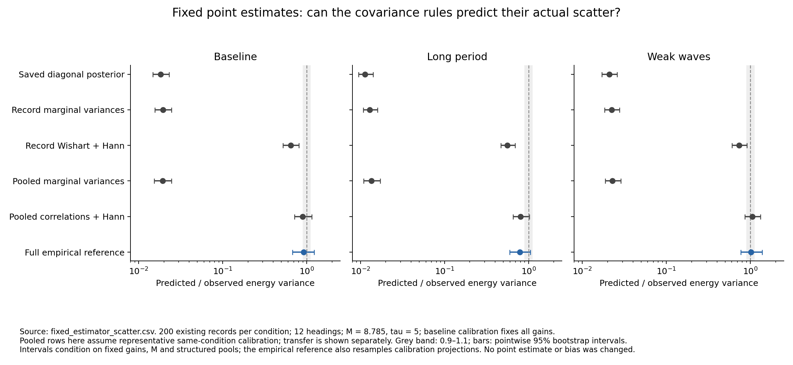
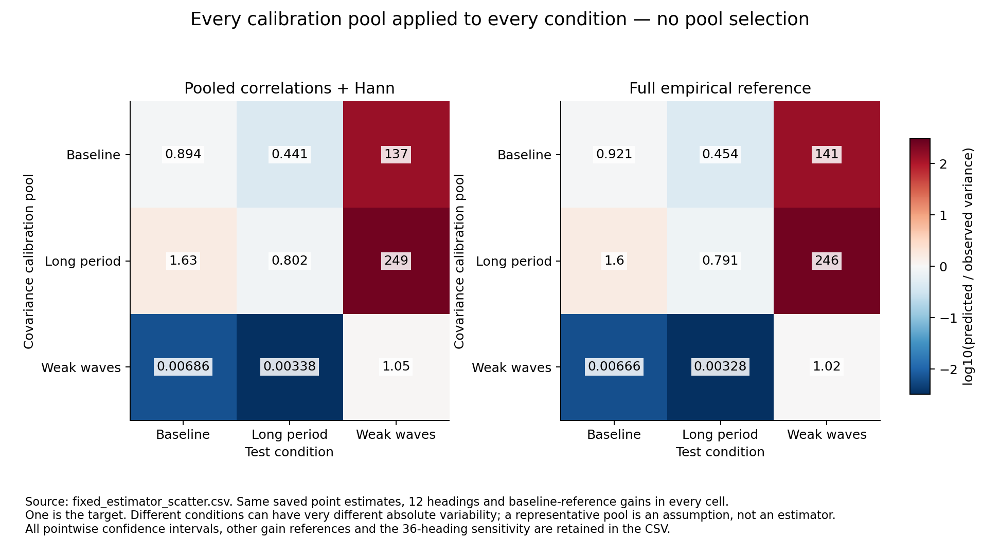

# Covariance prediction with the point estimator fixed

**Finding: representative pooled covariance predicts the actual energy scatter much better without changing any wave estimates. It is not yet a generally calibrated uncertainty rule.** The primary predicted/observed variance ratios are **0.894, 0.802 and 1.050**, compared with **0.018, 0.011 and 0.021** for the saved diagonal posterior. The confidence intervals remain too wide to establish agreement within 10%, baseline interval coverage remains below nominal, and mismatched calibration pools fail badly.

This is a retrospective analysis of 600 existing recordings from the [pooled-covariance study](pooled_covariance.md). It adds no simulations, changes no physical or statistical parameter, and does not rerun or alter the saved point estimates. M remains **8.785033150237455**, tau remains **5**, and the corrected marginal variance formula, response convention and original per-record prior scales are unchanged. This is the calibrated research estimator, not production M = 2.5. Main, the report and Drive data remain unchanged.

## The comparison

The actual point estimator is the previously saved `self_diagonal` estimate. We use its band energy and uncertainty from the existing score file; its fitted spectrum is never replaced. Thus height, period, direction, bias and recovery errors are identical across the uncertainty comparisons.

For each of the three independent calibration pools, build a reference energy gain g by freezing the diagonal inverse weights and prior scale at that pool's mean sensor spectrum. Use the existing batch response, without the later processing correction. For a real-stacked measured spectral vector d, this reference calculation is

    energy_ref = gᵀ d;     predicted sampling variance = gᵀ C_d g.

Here C_d is a covariance description of the sensor spectral fluctuations. The same g is used for every covariance rule in a comparison. We do not solve a new inverse using C_d. The gain is a reference linear approximation, not the full derivative of the data-dependent estimator. Its accuracy is measured against the actual saved outputs below.

Primary analysis: 12 headings and the **baseline calibration gain for all three test conditions**. All three reference gains and the 36-heading sensitivity are retained. No reference or covariance pool is selected using test truth or recovery quality.

The covariance descriptions are:

- The saved diagonal posterior variance, as the existing uncertainty control.
- Target-record corrected marginal variances propagated through g.
- Target-record Wishart correlations, with and without the existing Hann frequency coupling.
- Previously frozen pooled marginal variances, pooled within-frequency correlations, and pooled correlations plus Hann coupling.
- Full empirical covariance projected through g, and its within-frequency-only counterpart, as diagnostic references. Only the projected scalar/time-frequency quantities are formed; no unrestricted large covariance is inverted.

For pooled rules and empirical references, every calibration pool is applied to every test condition. The stationary same-condition comparisons below assume a representative pool exists; they do not supply an operational method for finding one.

## Does the reference calculation describe the actual estimator's scatter?

With the baseline gain fixed across conditions, reference variance divided by actual saved-estimator variance is:

- Baseline: **1.008**, paired 95% interval **0.989–1.026**.
- Long period: **1.060**, interval **1.041–1.081**.
- Weak waves: **1.043**, interval **1.020–1.064**.

All three intervals are inside the existing 0.9–1.1 practical comparison band. The approximation slightly overstates scatter in the latter two conditions; it is not exact. Across all three references and both heading grids, point ratios are 1.008–1.063 and interval endpoints stay within 0.989–1.083. Primary reference/actual correlations exceed 0.997, and centred RMS differences are about 6–7% of the actual standard deviation.

The means are different: the baseline-gain reference is **3.60, 2.47 and 4.23 energy percentage points higher** than the actual estimator. We do not substitute that reference estimate or correct this offset. All coverage and bias assessments use the original saved estimator. Agreement about scatter is not agreement about bias or point recovery.

Source: [all reference-approximation comparisons](fixed_estimator_approximation.csv).

## How well do the covariance rules predict actual scatter?



Ratios below use the variance of the actual saved estimator, not merely the reference projection. One is the target. For representative pooled correlations plus Hann frequency coupling:

- Baseline: **0.894**, 95% bootstrap interval **0.713–1.144**.
- Long period: **0.802**, interval **0.653–1.025**.
- Weak waves: **1.050**, interval **0.858–1.318**.

The full empirical reference gives **0.921 (0.674–1.227), 0.791 (0.598–1.055), and 1.019 (0.769–1.380)**. The pooled structure is close to that reference for this output. This does not establish accuracy in every sensor combination, frequency or directional component.

All six intervals include one, but **none establishes equivalence within ±10%**. In particular, the long-period point estimate remains about 20% low; available precision cannot distinguish that deficit decisively from sampling variation. These results support the uncertainty-propagation approach without certifying the absolute scale to high precision.

Target-record Wishart plus Hann, which needs no independent representative pool, remains too small: **0.644 (0.520–0.810), 0.558 (0.468–0.691), and 0.734 (0.603–0.907)**. All three intervals exclude one. It substantially improves on the diagonal description but is not an adequate replacement.

Keeping only correlations within each frequency also remains inadequate. Representative pooled within-frequency ratios are **0.460, 0.432 and 0.540**; adding Hann coupling gives the values above. The empirical within-frequency references are **0.491, 0.418 and 0.561**. Frequency correlation remains consequential for integrated energy.

The 36-heading sensitivity agrees with this pattern: representative pooled joint ratios are **0.892, 0.801 and 1.055**. This is a sensitivity result, not a selection of 36 headings or evidence of improved directional resolution.

## Coverage improves, but is not generally calibrated

We attach symmetric Gaussian energy intervals with the propagated variance to the **unchanged actual point estimates**. We do not remove mean error. The corresponding Hs bounds are monotone transformations of the energy bounds; negative energy bounds are clipped at zero. We do not assume Hs itself is Gaussian.

For nominal 95% intervals, representative pooled joint covariance gives:

- Baseline: **179/200 = 89.5%**, exact 95% interval **84.4–93.4%**, versus **21.0%** using the saved posterior.
- Long period: **186/200 = 93.0%**, interval **88.5–96.1%**, versus **11.5%**.
- Weak waves: **185/200 = 92.5%**, interval **87.9–95.7%**, versus **19.0%**.

Baseline undercoverage remains statistically visible. The other two intervals include 95%, which is insufficient to establish calibrated coverage. The representative full empirical reference gives 89.5%, 93.0% and 92.0%; it does not remove the problem either.

Mean full Hs interval widths rise from roughly **3.2–3.4% of true band Hs** to **23.3%, 30.2% and 23.6%**. Wider intervals are appropriate if previously understated scatter is represented, but coverage and useful width must be assessed together. These widths do not indicate worse point-estimation performance: point estimates are identical.

The actual estimator's energy biases remain **−6.14%, +0.27% and −6.37%**. This analysis does not prove how much each remaining coverage shortfall comes from bias, variance error or non-Gaussian tails. It does demonstrate that improving the variance alone does not eliminate all uncertainty errors.

## Transfer is the practical limitation



With the same baseline reference gain throughout, the pooled joint variance ratios are:

- Baseline pool: **0.894** on baseline, **0.441** on long-period records, **136.962** on weak waves.
- Long-period pool: **1.626**, **0.802**, **249.025**, respectively.
- Weak-wave pool: **0.00686**, **0.00338**, **1.050**, respectively.

The full empirical reference fails similarly when transferred. A baseline or long-period pool covers all weak-wave records only because its intervals are far too wide. A weak-wave pool gives roughly 7–12% coverage on the stronger-wave records. Neither result is calibrated inference.

These frozen pools carry **absolute marginal variances as well as correlations**. Large transfer errors therefore do not isolate failure of the correlation structure itself. They show that reusing the entire absolute covariance across different conditions is unsafe. The primary results above use one baseline gain across all conditions, so these changes are not caused by secretly choosing different estimation weights.

No automatic pool selector, target-record rescaling, additional variance multiplier or bias correction was introduced. Each pool contains 200 usable 900-second records: 50 hours of idealised stationary calibration. Its operational availability is not established.

## How sure can we be?

**Strong within the tested simulator:** ignoring correlations severely understates energy scatter; the unchanged point estimator can be analysed accurately enough with a frozen reference gain for this variance comparison; target-record Wishart plus Hann still underestimates; and absolute covariance does not transfer freely between conditions.

**Promising but imprecise:** representative pooled covariance predicts this estimator's variance reasonably closely and greatly improves interval coverage. With 200 test records per condition, its scale is not established within 10%; baseline coverage remains below 95%. No new unbiasedness or universal coverage claim follows.

**Not tested:** an operational representative-pool selection/adaptation rule, wider directions/depths/spreading, real-vessel records, or untouched final validation after these choices. The data were previously inspected. This is a retrospective mechanism test, not a new independent confirmation.

The 1,000 bootstrap draws resample whole test records, paired across methods, preserving sensor/frequency dependence. Structured-pool intervals condition on the already-fitted pools, frozen gains and M. The empirical-reference intervals additionally resample calibration projections while holding gains fixed. Neither integrates uncertainty from refitting the gains, M or structured covariance. Consequently their interval widths do not have identical conditioning. All intervals are pointwise, not simultaneous across the 342 comparisons. The binomial coverage intervals likewise condition on the frozen calibration.

## Decision

Keep M fixed. This test supports **improving sampling uncertainty without replacing the point estimator**. It does not justify merging the failed joint likelihood, inflating M to fix coverage, or declaring these propagated intervals to be a validated Bayesian posterior.

If we continue, the next narrowly justified question is whether the learned **correlation structure** can transfer when paired with marginal variances estimated from the target recording, using the already-calibrated formula. That would separate scale transfer from correlation transfer and still leave the point estimator unchanged. It is a proposed sensor-only rule, not a result demonstrated here; same-record interval dependence and residual bias would still require checks. A fresh final evaluation would follow any resulting method selection.

## Verification and reproduction

All 48 tests pass. New tests check the frozen gain against the specified Gaussian solve for different inputs, unit scaling, rejection of degenerate comparisons, preservation of point estimates and explicit failure of deliberately understated variances. Existing tests independently compare covariance propagation with a dense calculation.

The analysis verifies unchanged source and frozen pool hashes, retains all 600 test records and all pool/reference combinations, and records 342 unique comparisons and 18 gain-approximation checks. Source, settings and input-record hashes are saved in the protocol and manifest. The saved score file is checked unchanged before and after calculation. No inverse fits are recomputed except six sensor-mean reference solves used to define the diagnostic gains.

```sh
python WM/check_fixed_estimator_scatter.py
python WM/plot_fixed_estimator_scatter.py
python -m unittest discover -s WM -p 'test_*.py' -v
```

Use the same simulation environment as earlier studies to load the checked batch response builder. Existing `variance_output/m_calibration` and `variance_output/pooled_covariance` records are required. Small projection caches remain ignored under `variance_output/fixed_estimator_scatter`; no simulated data are generated. Five production source files and all 18 frozen report files are unchanged.
