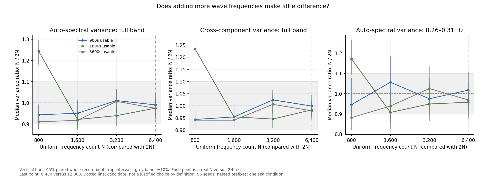
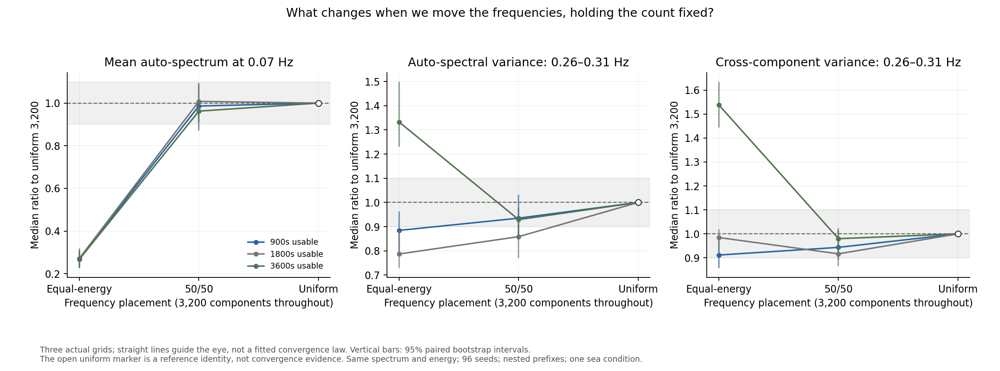

# Choosing the wave-frequency grid

Two questions need different evidence. A count-convergence test asks how many
components are enough within one grid family. A placement test asks why moving
the components changes the result at a fixed count. Neither test adjusts M or
uses inverse recovery error to choose a grid.

**Recommendation: 6400 uniformly spaced components is supported as a
conservative working reference for pooled spectral-variance investigations.**
It is the first tested count whose full-band auto- and cross-component
variance comparison intervals are all inside the 10% band at the three
recording lengths. This is not a claim of uniquely optimal resolution or
frequency-by-frequency convergence.

## Findings and interpretation

At 6400 versus 12800 components, the full-band median variance ratios are:

- 900 seconds: auto-spectra 0.991 (95% interval 0.932--1.041), cross-components
  0.999 (0.952--1.044).
- 1800 seconds: auto-spectra 0.975 (0.922--1.023), cross-components
  0.979 (0.940--1.017).
- 3600 seconds: auto-spectra 0.975 (0.928--1.020), cross-components
  0.983 (0.956--1.025).

All six intervals lie inside 0.9--1.1. The corresponding numbers of intervals
inside that band at lower counts are 2/6 at 800, 3/6 at 1600 and 5/6 at 3200.
This makes 6400 a defensible conservative choice within the tested counts.
It does not prove that 3200 is inadequate: one of its intervals narrowly
misses the band, so limited precision also affects that comparison.

The upper tail remains less certain. Its 6400/12800 auto-spectral variance
ratios are 1.018 (0.919--1.107), 0.969 (0.895--1.062) and 0.958
(0.876--1.026) for 900, 1800 and 3600 seconds. The point estimates are close
to one, but their intervals do not establish agreement within 10%.
Therefore the justified claim is pooled full-band stability, not universal
stability of all spectral entries. The six individual 95% intervals are not
a simultaneous 95% guarantee over every metric or frequency.

The placement experiment supports a separate explanation. At 0.07 Hz in the
hour-long records, the channel-median mean-spectrum ratio to uniform 3200
changes from 0.267 (0.228--0.305) for equal-energy placement to 0.962
(0.911--1.011) for the midpoint. In the upper tail, the cross-component
variance ratio changes from 1.538 (1.443--1.635) to 0.980 (0.929--1.024).
However, the midpoint auto-spectral variance ratio is 0.929 (0.844--0.977),
below the uniform reference rather than simply between the endpoints.
Placement does not produce a monotonic convergence law for every statistic.

These findings support using uniform 6400 for the next controlled M study,
with fresh calibration and held-out records at the intended native recording
duration. Tail precision and the physical-model limitations below must remain
visible. No M has been selected or changed here.

## Count convergence

The uniform frequency counts are 800, 1600, 3200, 6400 and 12800. Every point
in the plot compares a count N with 2N. Ratios near one mean that adding
components changes the measured variance little. The grey band is the
existing 10% comparison tolerance; vertical bars show 95% paired bootstrap
intervals. A point inside the band with an interval extending beyond it is
inconclusive at that tolerance.

The last point genuinely tests 6400 against 12800. There is no final
self-comparison with a ratio of one by definition. The vertical dotted line
marks 6400 as the candidate selected for investigation before this sweep;
it does not predetermine the conclusion.



The plot compares pooled auto-spectral and cross-component variances over
0.05--0.31 Hz and separately shows the auto-spectral upper tail. Mean-spectrum
and other sub-band comparisons are retained in `choice_summary.csv`.
`choice_frequencies.csv` gives frequency-specific channel-median ratios and
their intervals. Pooled agreement does not establish agreement for every
channel and frequency, nor prove that a count is uniquely optimal.

## Placement at a fixed count

The count stays at 3200. The three actual grids are equal-energy, a 50/50
intermediate grid and uniform spacing. We interpolate both the frequency-bin
edges and the component centres. Each new bin receives the energy obtained
by integrating the same JONSWAP CDF between its new edges. The total energy,
directional weights and phase draws are preserved.

This is a new simulation at the midpoint, not an interpolation of the measured
spectra or plotted results. Endpoint tests reproduce the original equal-energy
and uniform component frequencies and amplitudes. Three points provide an
initial placement diagnostic; they do not establish monotonicity between all
possible intermediate grids.



Here ratios use uniform 3200 as a comparison. Its open marker at one is an
identity, without an agreement confidence interval. Only the equal-energy
and midpoint comparisons provide new evidence. The plotted lines simply
connect the measured points and are not a fitted convergence law.

## Experimental controls

There are 96 seeds, 104000--104095, per case. Usable recording lengths are
900, 1800 and 3600 seconds, obtained as nested prefixes of long preprocessed
records. Seven distinct cases give 2016 spectral records; they are not 2016
independent realisations. Seed labels are paired across cases; changing a grid
does not preserve an identical realised wave field.

The equal-energy 3200, uniform 3200 and uniform 6400 cases are reused with
hash checks. The new cases are uniform 800, uniform 1600, uniform 12800 and
the 50/50 grid: 384 new full simulations. The protocol records the candidate,
counts, midpoint definition, seeds, fixed settings and source hashes before
the new comparisons are evaluated. Three inherited descriptive metadata
fields were clarified without changing simulations, sample counts or
statistical criteria; the initial snapshot is retained locally.

The source model remains main at `caaaf415dbe7bd372187758fe542c69999913d3e`:
90 m capsule, radius 5.36 m, depth 15 m, zero speed, Hs 1.7 m, Tp 8 s,
gamma 3.3, spreading s = 10, direction pi/2 and 36 generation directions.
All grids retain the original 0.1--2 rad/s generation range and integrated
wave energy. The BEM grid remains at 40 frequencies. Controller, nonlinear
drag, radiation memory, sensor errors and preprocessing are unchanged.
Welch uses 200-second Hann segments at 2 Hz with 50% overlap.

The bootstrap resamples whole seed records together, preserving correlations
between channels, frequencies and record lengths. It uses 1000 draws and the
same 10% comparison band as the earlier experiments. The reported intervals
are pointwise, not simultaneous guarantees across every spectral entry.

## Limits on the justification

A grid can be a reasonable conservative working choice without being the
smallest sufficient count. Conversely, a neat-looking curve cannot establish
equivalence when its intervals remain too wide. The count justification must
state which recording duration, frequency band and summary statistic passed.

These tests cover one simulated sea condition and inherited hull/noise model.
They do not validate the hydrodynamic discretisation, physical model, original
Drive recordings, native-duration processing, inverse recovery or posterior
coverage. These seeds are resolution diagnostics, not held-out evaluation
records for a subsequently calibrated M. The report, production model and M
remain unchanged.

## Reproduce

Use the environment in `convergence_environment.json`. The previous
`variance_output/uniform` records must exist first; see `variance_uniform.md`.

```sh
python WM/variance_choice.py --workers 2
python WM/analyse_variance_choice.py
python -m unittest discover -s WM -p test_spectral_variance.py -v
```

Raw records, hashes and the midpoint time-carrier cache remain under the
ignored `variance_output/choice` directory. Completed seeds are retained when
the study is restarted. The tests include energy/phase preservation, endpoint
agreement, direct harmonic-sum checks and known mean/variance scaling through
the two-experiment analysis.
