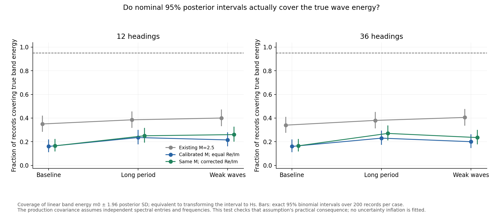
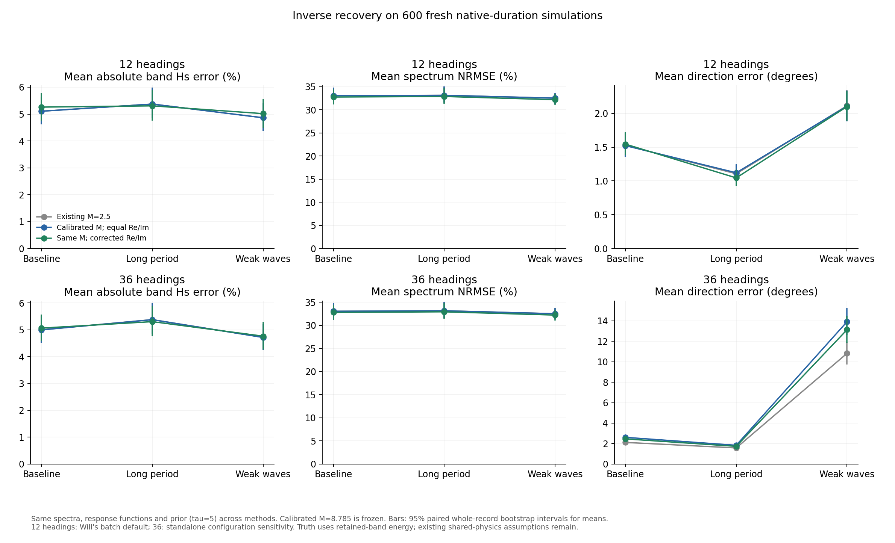
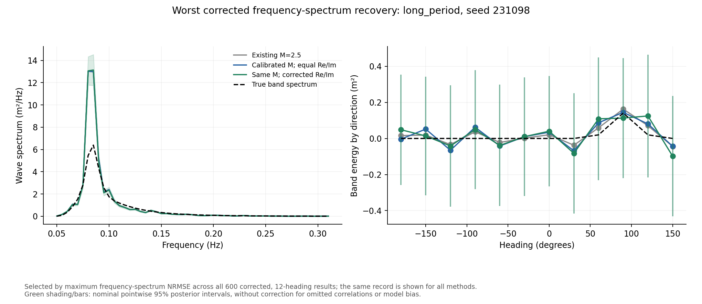
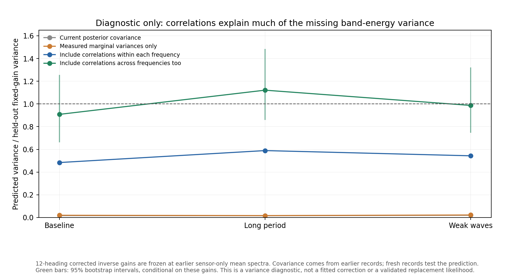

# Frozen inverse recovery check

**Do not adopt M = 8.785 plus the corrected variance formula as a drop-in
inverse change.** The sensor marginal variances are better calibrated, but
this does not make the current diagonal Gaussian likelihood adequate.
On 600 fresh simulations, wave-height recovery changes little, the full
directional distribution deteriorates, and nominal 95% band-energy intervals
cover truth in only **16.5--26%** of records with the candidate.

The original M = 2.5 setup also undercovers badly, at **35--40%**. This
quantifies the existing warning about optimistic Hs uncertainties already
printed by invert_waves.py; the underlying problem predates this proposal.



## What was kept fixed

The variance-only study's M = 8.785033150237455, corrected formula and tau = 5
were frozen before generation. The 600 new seeds are baseline
230000--230199, long period 231000--231199 and weak waves 232000--232199.
None overlaps the M calibration or previous variance validation records.
No inverse recovery score or wave truth was used to select M, the formula,
tau, or a favourable heading grid.

Each recording uses the same proposed 6400 uniform wave components, 36
generation directions, 40 BEM frequencies, 90 m hull, 5.36 m radius, 15 m depth
and zero speed as the preceding studies. Baseline is Hs = 1.7 m, Tp = 8 s;
long period changes Tp to 12 s; weak waves changes Hs to 0.5 m. Gamma = 3.3,
spreading s = 10 and mean travel direction pi/2 are unchanged.

All are native 1200-second time simulations with nonlinear drag, controller,
radiation memory and the existing sensor errors. The first 300 seconds are
discarded; actual inverse preprocessing supplies 1800 samples at 2 Hz.
Welch uses 200-second Hann windows, 50% overlap, and the 53 bins with centres
0.05--0.31 Hz. The previously checked accelerated harmonic sum is reused;
it does not replace hull integration or change the physical equations.

Three methods see exactly the same spectra, operators and prior:

1. The original equal-real/imaginary variance formula at M = 2.5.
2. The same formula with calibrated M = 8.785.
3. The coherence-aware finite-average correction at that same calibrated M.

The inverse is the actual, unchanged iw.invert function. A temporary function
substitution supplies candidate variances and is restored immediately after
each call. Will's unchanged batch RAO builder is used with the checked BEM
cache, including its viscous damping and controller. It is not the older
standalone RAO-loading path. Known hull and sensor geometry are supplied;
generating phases, true wave spectrum and motion history are not estimator
inputs. The data-derived prior scale is computed exactly as before.

The primary inverse grid is Will's batch default: 12 headings, every third
generation heading. The standalone 36-heading configuration is a prespecified
sensitivity check. There are **3600 inversions**: 600 records x 3 methods x
2 heading grids. No run failed or was removed.

## Truth and uncertainty bookkeeping

The target is the ensemble directional wave spectrum, not instantaneous
surface elevation. The simulator's discrete frequency energies are summed
into the retained Welch cells and divided by their 0.005 Hz width. These
cells have edges 0.0475--0.3125 Hz. Generation directions are grouped to the
nearest inverse heading, as in Will's batch scoring. The operator still uses
one response at each bin centre; grouping does not remove angular or spectral
discretisation mismatch from the experiment.

Band Hs is computed from this same retained energy, so frequencies omitted
by the inverse are not incorrectly counted as estimation error. Errors
against full-sea Hs are also saved separately. Truth is constructed for
scoring only, after all three methods have been inverted for a case.

The frequency-spectrum NRMSE is the L2 error divided by the L2 norm of the
true spectrum. Direction error uses a circular mean. Directional-shape
distance is half the L1 distance between signed normalised direction-bin
energies. It can exceed one because the Gaussian inverse allows negative
power; it is not a probability or fraction of wrongly directed waves.

Coverage is checked for the linear band energy m0 using the production
covariance: m0 +/- 1.95996 times its posterior standard deviation. Its
monotone Hs transformation has the same coverage. This avoids attributing
failure solely to the delta-method Hs standard deviation. Covariance between
headings is retained when summing energy; the existing assumptions of
independence between measured spectral entries and between frequencies are
not silently repaired. The reported coverage is conditional on frozen M;
calibration uncertainty is not added to those posterior intervals.

Error and paired-change intervals use 1000 whole-record bootstrap resamples.
Scalar coverage uses exact 95% binomial intervals over 200 records per case,
including a nonzero upper bound when no events are observed. Pointwise
spectral/active-direction coverage and worst five records are also saved.
Intervals for the several metrics are not simultaneous guarantees.

## Recovery results: primary 12-heading grid

With corrected variances and M frozen, mean absolute band-Hs errors are:

- Baseline: **5.259%**, 95% bootstrap interval **4.753--5.781%**.
- Long period: **5.306%**, interval **4.754--5.883%**.
- Weak waves: **5.016%**, interval **4.473--5.559%**.

Original M = 2.5 errors are 5.106%, 5.373% and 4.863%. The candidate changes
are +0.153, -0.067 and +0.153 percentage points. The long-period change is
not resolved by its paired interval; the other two are small deteriorations.
There is no general wave-height improvement.

Frequency-spectrum NRMSE falls from 33.06%, 33.15% and 32.52% to 32.77%,
32.89% and 32.19%. Paired intervals support these reductions, but they are
only about 0.26--0.33 percentage points. Accurate integrated height should
not be confused with a precisely recovered frequency spectrum.

Mean-direction errors are 1.54, 1.04 and 2.10 degrees for the candidate,
versus 1.53, 1.11 and 2.11 degrees originally. This small change hides a
larger problem with the full direction distribution. Signed directional L1
distance rises from 0.292 to 0.539 at baseline, 0.801 to 1.480 for long
period, and 0.261 to 0.439 for weak waves. All three paired change intervals
are positive. Much of that deterioration already occurs when M alone is
increased: poorly resolved components receive less relative regularisation.

The candidate's negative power is 34.1%, 44.5% and 34.3% of total absolute
estimated power, versus 29.2%, 38.4% and 30.3% originally. The prior was not
retuned and positivity was not imposed to improve these outcomes.



The 36-heading sensitivity does not rescue the proposal. Height and spectrum
errors are similar, but weak-wave mean-direction error is 13.14 degrees for
the candidate versus 10.82 degrees originally. Individual 36-heading power
components have extremely broad posterior intervals, while summed energy
remains overconfident. One coverage summary cannot represent all functionals
of this ill-resolved spectrum.

## Coverage failure is decisive

For the corrected 12-heading method, nominal 95% band-energy coverage is:

- Baseline: **33/200 = 16.5%**, exact interval **11.6--22.4%**.
- Long period: **50/200 = 25.0%**, interval **19.2--31.6%**.
- Weak waves: **52/200 = 26.0%**, interval **20.1--32.7%**.

These intervals are far below 95%. The corresponding mean posterior band
energy variance is only 1.97%, 1.67% and 2.11% of the observed repeat-record
variance of the estimate. This is a large uncertainty failure, rather than
an unresolved small effect. The old M = 2.5 inflates marginal error bars but
does not provide calibrated inverse uncertainty either.

The worst corrected frequency-spectrum recovery among all 600 primary-grid
records is long-period seed 231098: NRMSE 94.37%. The figure deliberately
shows this record for every method, rather than selecting a favourable
example. The maximum absolute height error is 22.78% in the long-period
case; the 95th-percentile absolute errors are 11.54%, 13.31% and 12.86%.



## Diagnostic: what omitted correlations contribute

This additional diagnostic was performed after observing undercoverage; it
was not used to retune the inverse or to select M. A reference sensor spectrum
and variability are taken from earlier records: baseline training seeds
207000--207199, and previous sensor-only long/weak records 209000--209199
and 210000--210199. The fresh inverse records remain separate.

For each frozen method, form its linear band-energy gain at that earlier
mean spectrum. Apply the same gain to the earlier and fresh measured
spectral vectors. No wave truth is needed for this variance comparison.
Propagate the earlier observed covariance in three stages:

1. Retain only each spectral entry's measured marginal variance.
2. Include covariance between entries at the same frequency.
3. Include covariance across frequencies as well.

For corrected 12-heading gains, step 2 raises propagated variance by factors
**24.50, 34.92 and 24.37** relative to step 1. Step 3 adds factors **1.876,
1.903 and 1.816**. Together the factors are **45.98, 66.45 and 44.26**.
The 36-heading gains give similar results. These factors apply to the
band-energy functional and this diagnostic, not to every posterior component.

The earlier full-covariance predictions divided by fresh fixed-gain variances
are **0.908, 1.121 and 0.987**, with bootstrap intervals **0.661--1.255**,
**0.858--1.485** and **0.745--1.321**. They are consistent with one, but are
not precise enough to establish +/-10% equivalence. Fresh fixed-gain variance
is within about 3--5% of the variance of the actual data-dependent inverse
in these cases. This is strong evidence that omitted correlations explain
much of the variance deficit; it does not rule out model bias or validate a
new covariance estimator.

No 4293-by-4293 sample covariance was inverted. The scalar gain projections
give this diagnostic without pretending that 200 records determine a full
high-dimensional covariance. This diagnostic is not a new likelihood or a
production uncertainty correction.



## Verification and limits

All 24 tests pass. Checks cover energy-preserving truth rebinning, signed
covariance aggregation, deliberate recovery errors, paired record alignment,
exact zero-event coverage intervals and a controlled algebraic inverse
fixture. For the first record in each case/grid/method, a separately scaled
Cholesky solve agrees with the production inverse to better than 1.8e-7 in
relative posterior mean and 1e-8 in covariance over all frequencies. The
largest scaled precision condition number is about 2.06e8. This does not
suggest that the observed coverage failure is a matrix inversion accident.
It is not a proof of physical model correctness.

The model source, methods, seed groups and truth convention are in the saved
protocol. The manifest hashes the 600 raw spectral records and evaluation
and analysis scripts. Per-record scores, paired summaries, uncertainty
ratios, numerical checks, covariance diagnostics and worst-record lists are
committed. Raw spectra and fitted arrays remain ignored. Production source
and the report have not been changed.

This is held-out validation under the existing shared BEM/generator physics.
It is not a sea trial, independent hull model, validation of the historical
Drive archive, or a guarantee for other directions, spreading, depths or
recording lengths. Those existing shared-model assumptions were preserved,
as requested. The algebraic test fixture is a unit test, not recovery evidence.

## Recommendation

Keep the calibrated M as evidence about sensor marginal variances, while
withholding the proposed drop-in inverse change. Do not choose a smaller M
by inverse recovery or coverage to hide omitted covariance. Do not introduce
M(f) as a substitute for correlations.

The next targeted work should address covariance propagation or a structured
correlated likelihood, using sensor-only calibration and fresh validation.
Directional regularisation and negative power require a separate explicit
decision. A reliable uncertainty fix should be demonstrated before merging
production changes or regenerating the Drive data.

To reproduce, after the earlier calibration data exist:

```sh
python WM/check_inverse_recovery.py --generate --workers 2
python WM/check_inverse_recovery.py
python WM/analyse_inverse_recovery.py
python WM/diagnose_inverse_covariance.py
python -m unittest discover -s WM -p test_spectral_variance.py -v
```
