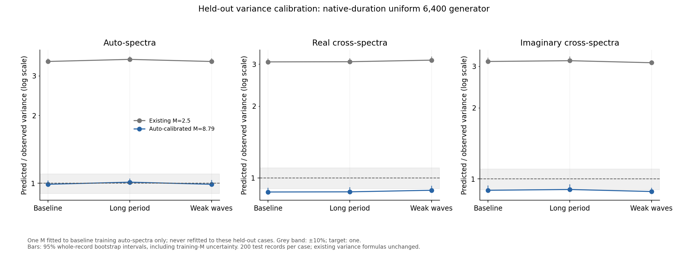
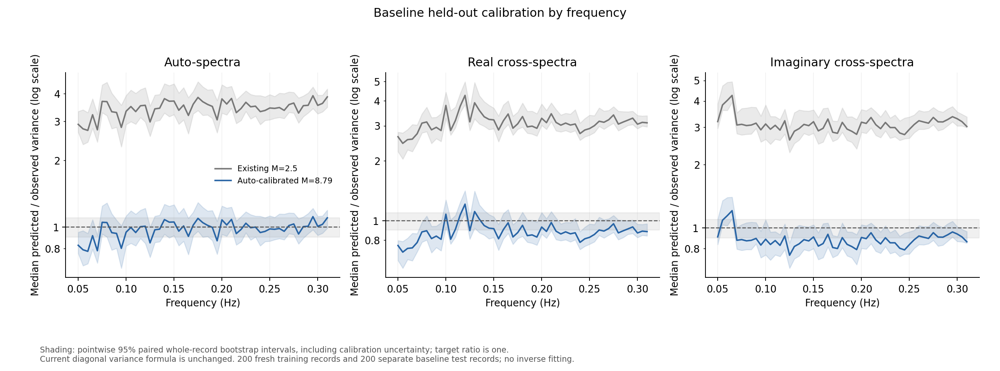

# Calibrating M from repeated native-duration sensor records

Follow-up: [cross-spectral formula check on 600 additional held-out records](cross_variance.md)
tests a coherence-aware finite-average correction while keeping this M fit fixed.

## Finding

For the proposed uniform 6400-component generator, the prespecified
auto-spectral calibration gives an **input M of 8.785**, with a 95% bootstrap
interval of **8.602--8.991**. It transfers well to held-out auto-spectral
variances in the baseline, long-period and weak-wave cases.

This is a backed candidate for the implemented variance scale, not a validated
drop-in replacement for every likelihood weight. Cross-spectral calibration
improves substantially over M = 2.5, but retains systematic differences and
larger entry-wise errors. Production code, the report and M = 2.5 are unchanged.



## Training and untouched validation

The two generators are kept separate. The primary proposal uses 6400 uniformly
spaced components with the BEM response grid held at 40. A current-main control
uses the original 40 equal-energy components, also with the 40-frequency BEM
grid. The control is not a provenance verification of the historical Drive ZIP.

Each mode has 200 baseline training records (seeds 207000--207199) and 200
separate baseline test records (208000--208199). The proposed generator also
has 200 held-out long-period records (209000--209199) and 200 weak-wave records
(210000--210199). There are 1200 new full simulations in total. None of these
seeds was used in the earlier resolution experiments.

All recordings are generated for 1200 seconds and processed at their native
duration, rather than being prefixes of longer records. The first 300 seconds
are discarded, leaving 1800 samples at 2 Hz. Welch uses 200-second periodic
Hann segments with 50% overlap; analysis retains 0.05--0.31 Hz.

The baseline is Hs = 1.7 m, Tp = 8 s; long-period changes Tp to 12 s; weak-wave
changes Hs to 0.5 m. The fixed settings are the 90 m hull, radius 5.36 m,
depth 15 m, zero speed, gamma 3.3, spreading s = 10, direction pi/2 and
36 generation directions. The controller, nonlinear drag, radiation memory,
sensor errors and preprocessing remain those of main at
`caaaf415dbe7bd372187758fe542c69999913d3e`.

## What was fitted

For each spectral entry, let q be the numerator returned by the existing
`noise_variances` function with M = 1. Its reported variance is q/M. We measure
the repeat-record variance v independently across the training records.
The single primary M is the median of mean(q)/v across the 477 auto-spectral
channel/frequency entries. Real, imaginary and all-entry estimates are
diagnostics, not alternative values selected after seeing validation results.

Auto-spectra were prespecified for the primary fit because the cross-spectral
formula introduces the additional approximation of equal real and imaginary
variances. Those cross-spectral weights must therefore be tested separately.
No M(f) is fitted. The inverse, prior, wave truth and response matrix are not
used to choose M.

Bootstrap intervals use 1000 whole-record resamples. Validation resampling is
independent of training resampling; its calibrated-M intervals include
uncertainty in the training fit. The fitted M is frozen for all held-out
conditions. These are pointwise sampling intervals conditional on this
simulator, not simultaneous or physical-model confidence guarantees.

## Held-out results

Ratios below are mean predicted variance divided by repeat-record variance,
summarised by the median across the full band and the specified family.
A ratio of one is the target.

- Baseline auto-spectra: M = 2.5 gives 3.475 (95% interval 3.415--3.580).
  The frozen calibrated M gives 0.989 (0.963--1.026).
- Long-period auto-spectra: 3.550 (3.493--3.651) becomes 1.010
  (0.983--1.048).
- Weak-wave auto-spectra: 3.474 (3.444--3.592) becomes 0.989
  (0.971--1.032).

All three pooled auto-spectral intervals fit inside the 10% comparison band.
Their median entry-wise multiplicative errors are about 1.06--1.07, versus
3.47--3.55 with M = 2.5. This is held-out evidence, not the automatic
training fit to a median ratio of one.

Cross-spectra improve but do not fully calibrate. With M = 8.785, the pooled
real-component variance ratios are 0.872, 0.874 and 0.887 for baseline,
long-period and weak-wave cases. Imaginary ratios are 0.895, 0.902 and 0.884.
They are around 10--13% low at this aggregate level. Median entry-wise factor
errors remain about 1.37--1.52. The old M gives pooled ratios around 3.1.
The change in median absolute log-calibration error is negative for every
tested family/condition, with all full-band bootstrap intervals below zero;
this does not mean every individual entry improved.



Separate training diagnostics also disagree: real cross-components require
a median input scale of 7.765 (7.744--8.017), imaginary components 8.066
(8.013--8.297), and all entries together 8.139 (8.107--8.339).
These differences and the frequency plot show a limit of a single scale
under the current variance approximation. The equal-real/imaginary formula
is a specific next target to inspect; its causal contribution has not been
isolated by this study. The diagnostic all-entry value is not silently
substituted for the prespecified primary estimate.

For the current-main 40-component control, the corresponding auto-calibrated
input M is 3.748 (3.611--4.059). On its baseline held-out set the auto-spectral
ratio improves from 1.613 to 1.076, but frequency/entry-wise discrepancies
remain much larger than for the proposed generator. This demonstrates why
the two calibrations must not be transferred between data-generation settings.

## Why input M is not a literal segment count

The code squares the estimated auto-spectrum in each recording. Consequently,
mean(q) is mean(estimated S squared), not mean(estimated S) squared. The
variance-equivalent averaging diagnostic based on the latter is 7.790
(7.607--7.996) for the proposed generator, versus input M = 8.785.

For R training records, the sample-moment identity gives

    mean(S_hat^2)/v = mean(S_hat)^2/v + (R-1)/R.

Here R = 200, so the difference is 0.995. This is why an input value above
eight is not evidence of more than eight independent Welch segments. The
fitted value calibrates the implemented estimated-spectrum numerator; it
should not be described as a literal count of averaged segments.

## Scope and next targeted work

This study preserves the existing matched synthetic forward/inverse
assumptions, as requested. It introduces no inverse recovery-based tuning:
training and validation seeds are disjoint, no wave truth is supplied to the
calibrator, and the inverse is not run. It does not claim to remove existing
inverse crimes or establish real-vessel performance.

The next targeted step is to inspect the cross-spectral variance expression
and its real/imaginary approximation before applying the new scale to every
likelihood entry. Diagonal-variance calibration does not validate omitted
correlations, posterior coverage or wave recovery. M should not be retuned
to hide these different errors. Any revised expression needs a fresh final
test set after development.

The final report and full Drive-data regeneration can follow a consistent
choice of generator and variance formula. The old Drive recordings are not
overwritten or relabelled by this study. Other hull depths, short-period seas
and the full original parameter sweep have not yet been validated here.

## Verification and reproduction

Native-duration accelerated/original checks at 40 components passed in all
three conditions, with maximum processed-channel scaled differences below
4e-13. Forcing and incident-pressure checks also compare the accelerated
sums with original expressions. Automated tests verify actual variance
numerators, unit invariance, the sample-moment identity, disjoint train/test
seeds, and that deliberately miscalibrated held-out data do not cause refitting.

Use the environment in `convergence_environment.json` and the cached
40-frequency hydrodynamic data from `variance_output/uniform/hydrodynamics.npz`:

```sh
python WM/calibrate_m.py --workers 2
python WM/analyse_m_calibration.py
python -m unittest discover -s WM -p test_spectral_variance.py -v
```

`m_calibration_protocol.json` records the experiment settings. The fit,
validation, frequency and score CSVs retain numerical results. Raw spectral
records, the hydrodynamic cache and acceleration checks remain in the ignored
`variance_output/m_calibration` directory. Existing completed records are
reused on restart; production source files are unchanged.
