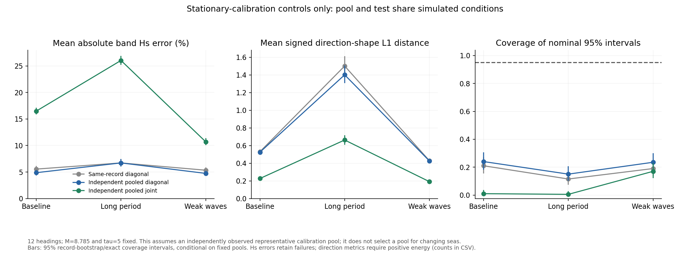
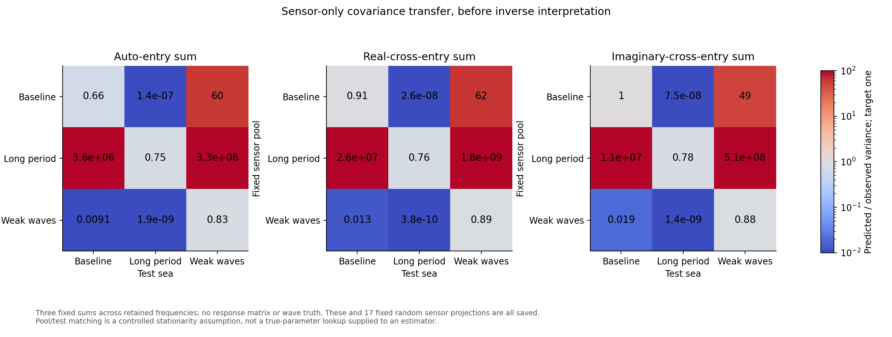
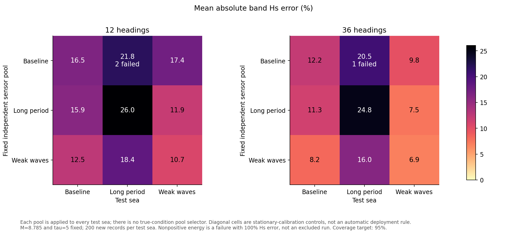
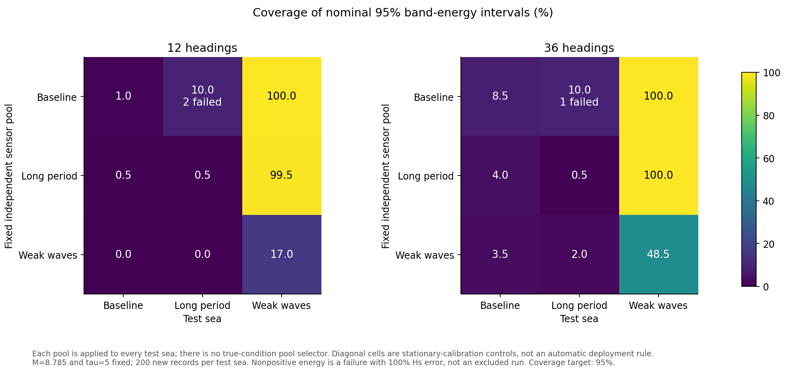

# Independent pooled sensor covariance

Follow-up: [mean-spectrum audit and assessment of defensible variance
parameters](spectral_mean_audit.md) identifies specific observation/dynamics
mismatches while retaining the sensor-only M calibration.

**Finding: independent pooling is not an adequate inverse fix.** Pooled
diagonal weighting slightly reduces some height biases, but pooled joint
covariance gives large downward height errors and poor coverage even with
a representative stationary calibration pool. The mean-response diagnostic
below points to an additional problem with the expected sensor spectrum.
This candidate should not be merged or described as a validated final method.



This follows the [same-record correlated-covariance failure](correlated_covariance.md).
The test freezes M = 8.785033150237455 and tau = 5, learns covariance from
separate sensor recordings, and evaluates both stationary calibration and
transfer. Main, production code, Drive data and the report stay unchanged.

## The question and the controls

The preceding experiment improved some covariance predictions but introduced
downward height bias. Exchanging covariance between independent baseline
recordings reduced that bias, without fixing coverage. Here we replace a
single noisy covariance estimate with a pool, while preserving target-record
marginal variances and checking representativeness explicitly.

Three pools contain 200 earlier sensor recordings each:

- Baseline: 207000--207199, the original baseline training sensor records.
- Long period: 209000--209199, previous sensor-only validation records.
- Weak waves: 210000--210199, previous sensor-only validation records.

Covariance estimation receives only those recorded spectral matrices and M.
It does not receive generating parameters, phases, wave truth, A or inverse
output. The pools are fitted before fresh test generation. Every resulting
matrix is fixed and applied to **every** test condition. There is no pool
selector using true sea conditions or inverse recovery quality.

The nine pool/test combinations are deliberately distinct:

- Same-condition combinations are controlled **stationary-calibration**
  scenarios, assuming an independently observed representative pool exists.
- Different-condition combinations stress transfer when that assumption
  fails. They are not combined into a best-pool-per-case estimator.

Success on same-condition cells would not validate an operational method
for selecting or adapting covariance in a changing sea. A 200-record pool
contains 50 hours of usable 900-second data. That is an idealised calibration
experiment, not an assertion that real seas stay stationary for that long.
Existing shared simulator physics remains; fresh seeds do not establish
independent physical validation.

## Covariance construction

For each frequency, estimate the correlation of the 81 real spectral entries
across the independent calibration records. The observations are centred
and scaled using their calibration sample standard deviations. Estimate a
diagonal-target shrinkage intensity from the summed variance of off-diagonal
correlations divided by their summed squared values, clipped to [0,1]. This
uses sensor statistics only, following the framework of
[Schafer and Strimmer (2005)](https://strimmerlab.github.io/publications/journals/shrinkcov2005.pdf).
No intensity is selected using a true spectrum or inverse coverage.

The target diagonal variance is the average of the earlier fixed-M corrected
variance estimates, not the variance of their mean:

$$
D_{f,a}^{\,2}=\frac{1}{N_{\mathrm{cal}}}
\sum_{r=1}^{N_{\mathrm{cal}}}\widehat v_{r,f,a}(M).
$$

This estimates noise in a **new native-duration recording**. It is not divided
by N_cal again. Pooling reduces uncertainty in our covariance estimate, not
the physical variability of the new recording. M retains its existing
meaning and numerical value.

If the shrunken empirical correlation is R_f, set

$$
F_f=D_f R_f^{1/2},\qquad
\Sigma_{fg}=W_{fg}F_fF_g^T,
$$

using the principal real symmetric square root. W is the existing normalised
Hann/overlap frequency-correlation matrix. This preserves the calibrated
diagonal, guarantees a positive-definite structured model, and learns
within-frequency correlations empirically rather than from a noisy per-record
Wishart coherence matrix.

Cross-frequency alignment through these roots and the locally flat Gaussian
window calculation remain approximations. We do not pretend to estimate an
unrestricted 4293-by-4293 covariance from 200 observations. Covariance-estimate
uncertainty is not integrated into the plug-in Gaussian posterior; test
intervals are conditional on each fixed calibration pool.

## Fresh validation

There are 600 new native-duration recordings: baseline 250000--250199,
long-period 251000--251199 and weak-wave 252000--252199. All are separate
from calibration and earlier inverse tests. The 90 m hull, 6400 uniform wave
components, 40 BEM frequencies, sensors, time simulation and preprocessing
are unchanged from previous experiments.

Each recording is inverted using 12 and 36 headings, with:

1. The same-record corrected diagonal estimator as control.
2. Each of the three independent pooled diagonal covariances.
3. Each of the three independent pooled joint covariances.

This gives 8400 inversions. Recipient data, operators, tau and data-derived
prior scales are identical across methods. Pooled diagonal is an important
control: it separates independent weighting from adding correlations.
The joint posterior carries frequency correlations into band-energy variance.
Wave truth is constructed only after every inverse for a recording finishes.

Before interpreting recovery, compare predicted and repeat-record variances
for the same 20 fixed sensor-only projections used in the last study. Their
units were fixed from the earlier baseline sensor records; they use no A or
wave truth. Recovery metrics include band Hs, frequency-spectrum NRMSE,
circular mean direction, full signed direction-shape distance, negative
power, and nominal 68%/95% band-energy coverage.

Error differences use 1000 paired whole-record bootstrap draws. Scalar
coverage uses exact binomial intervals. These are conditional on the fixed
pools and are not simultaneous confidence guarantees. Neither a good median
sensor projection nor improved height alone establishes calibrated inference.

The source rule and pool-file hashes are recorded before fresh outcomes.
Checks include physical-unit invariance, positive-definite shrinkage, and
the fact that repeating calibration rows does not divide the target-record
variance by the increased row count. Earlier controlled tests still check
joint Gaussian algebra and frequency-covariance propagation.

## Results: stationary calibration

All 600 fresh recordings were evaluated on both direction grids with all
seven covariance choices: **8400 scored inversions**. No record or transfer
combination was removed. The primary 12-heading results are:

- Baseline mean absolute Hs errors: same-record diagonal **5.55%**, independent
  pooled diagonal **4.87%**, pooled joint **16.48%**. The joint error interval
  is **15.88--17.11%**. Nominal 95% energy coverage is **2/200 = 1.0%**,
  exact interval **0.12--3.57%**.
- Long period: errors **6.72%, 6.72%, 26.04%**. The joint interval is
  **25.19--26.88%**, and coverage is **1/200 = 0.5%**, interval **0.013--2.75%**.
- Weak waves: errors **5.34%, 4.74%, 10.70%**. The joint interval is
  **10.06--11.39%**, and coverage is **34/200 = 17.0%**, interval **12.07--22.94%**.

The 36-heading sensitivity does not resolve the failure: pooled joint
absolute errors are **12.18%, 24.84% and 6.87%**, with coverage **8.5%, 0.5%
and 48.5%**. Better direction-shape recovery on some primary-grid cases does
not make the height and uncertainty failures acceptable.

Independent pooled diagonal weighting reduces baseline and weak-wave signed
height biases from about -3.3%/-3.4% to -1.5%/-1.6%. That supports the earlier
same-data feedback diagnosis, but primary-grid coverage remains only 15--24%.
Independence alone does not repair the likelihood.

## Sensor variance and covariance transfer

For representative pooled joint covariances, predicted-to-observed variance
ratios for fixed auto/real-cross/imaginary-cross sums are:

- Baseline: **0.657, 0.910, 1.032**; intervals **0.551--0.796, 0.739--1.159,
  0.851--1.290**.
- Long period: **0.751, 0.759, 0.779**; intervals **0.529--1.109,
  0.535--1.120, 0.544--1.161**.
- Weak waves: **0.834, 0.893, 0.883**; intervals **0.704--1.023,
  0.749--1.086, 0.756--1.050**.

These improve many diagonal projections but do not establish uniformly
calibrated covariance. The baseline auto sum remains clearly underestimated.
All 20 projections and every pool/test combination are reported.



Transfer is unsafe without a representative calibration procedure. A baseline
pool applied to long-period tests gives **21.81%** mean absolute Hs error and
**10%** coverage on the primary grid. A stronger-wave pool applied to weak-wave
records can give almost 100% coverage because intervals are far too wide;
that is not calibrated uncertainty.

Two primary-grid baseline-pool/long-period transfers and one corresponding
36-heading transfer have **nonpositive inferred total energy**. All three are
retained as failed recoveries. Hs is clipped to zero as in production, giving
100% height error; direction and delta-method Hs-SD are undefined and marked
missing. Direction summaries report valid counts and all failed recoveries.
Formal linear-energy coverage and height failures remain in the full sample.





No selection rule chooses a favourable pool from these results. The diagonal
of these grids is a controlled stationarity assumption, not an oracle-based
deployment algorithm.

## Post-validation diagnostic: prior versus mean response

A separate diagnostic freezes prior scales at the independent calibration
mean and applies the same recovery operator to two mean inputs: the current
forward model's expected spectrum A x_true, and the average measured spectrum
from the 200 fresh tests. True x is used only for validation and algebraic
bias decomposition, never to fit covariance, A, M or the prior. The model-mean
input is not an additional simulated recovery test or independent evidence.
Superposition of model and residual inputs is checked explicitly.
The six decompositions are saved in
[the mean-response diagnostic](pooled_covariance_mean_diagnostic.csv).

On 12 headings, prior shrinkage changes recovered band energy by only
**-0.102%, -0.125% and -0.118%**. Applying the recovery operator to the difference
between observed and predicted mean spectra contributes **-29.95%, -44.80%
and -19.57%** of true band energy. The sums closely match actual average
energy biases of **-30.06%, -44.93% and -19.71%**.

On 36 headings, prior biases are about -0.05% and mean-mismatch contributions
are **-22.62%, -43.13% and -12.01%**. The reference-prior calculation matches
actual average energy bias within 0.021 percentage points across all six
cases. The large height bias is not explained by insufficiently wide tau
in this comparison.

This strongly indicates a mismatch between the model's expected spectra and
the processed observations under the present truth/bin mapping. It does not
identify its cause. Candidates to audit include spectral-window averaging,
frequency/heading discretisation, sensor-noise mean power, and differences
between linear responses and native time simulation. Neither a particular
physical bug nor a corrected mean model is established by this diagnostic.

The next targeted task should audit the **mean spectral measurement model
and scoring convention**, rather than keep sweeping covariance or M. Do not
fit A or an offset against x_true merely to make this check pass, and do not
copy generator-specific numerical artefacts into the inverse. Any correction
needs an independent justification from the observation process, measured
sensor behaviour or physical modelling, followed by fresh validation.
Correlations still matter; they are not the only issue.

## Numerical amendment during evaluation

The initial unscaled normal-equation solve lost positive definiteness in an
off-condition transfer case. Its 215 cached results were preserved separately
and are not mixed into the final evaluation. The replacement first uses a
small SVD at each frequency to precondition by that frequency's likelihood
and the unchanged prior, then solves the same joint Gaussian model. In the
transformed coordinates the precision is bounded by the frequency-kernel
precision and the prior, rather than by enormous sensor-level scale ratios.
Only singular values below the ordinary float-precision numerical-rank
threshold are discarded.

Controlled tests verify agreement with the previous Gaussian calculation on
well-scaled inputs and retention of the prior in an extreme rank-deficient
case. The original covariance-fitting source was reconstructed and its hash
matched the pre-run source exactly. All three pool-file hashes, M and tau
are unchanged. The amendment is recorded explicitly, and all test recordings
are rerun with the stable solve before outcomes are interpreted.

All 36 tests pass. The final audit verifies 8400 unique scores in 42 groups
of 200, disjoint calibration/test seeds, unchanged calibration-matrix hashes,
and explicit retention of all three nonpositive-energy failures. The maximum
scaled linear-solve residual is 5.72e-17. Five production source files still
match main, and all 18 recorded report-file hashes are unchanged. These are
reproducibility and numerical checks, not evidence of physical validity.

## Reproduction and later adoption

```sh
python WM/check_pooled_covariance.py --generate --workers 2
python WM/check_pooled_covariance.py --workers 2
python WM/analyse_pooled_covariance.py
python WM/diagnose_pooled_mean.py
python -m unittest discover -s WM -p 'test_*.py' -v
```

Calibration matrices, raw test spectra and fitted arrays remain ignored.
Source, aggregate results, protocol, manifests and plots belong on the
exploration branch. No main merge or Drive regeneration occurs in this test.

Any later adoption must address calibration availability, pool-size
sensitivity and sea changes without a true-condition lookup. Preserve the
[merge, regeneration and report handoff](correlated_covariance.md#later-merge-regeneration-and-report-handoff):
separate wave and BEM grids before regeneration; verify acceleration and
metadata; describe the implemented covariance and joint-frequency treatment
honestly; preserve settled report prose; and keep directional negativity
and existing shared-model assumptions explicit.
