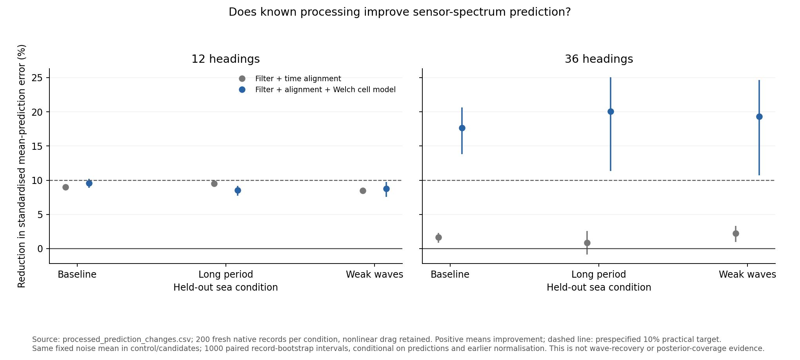
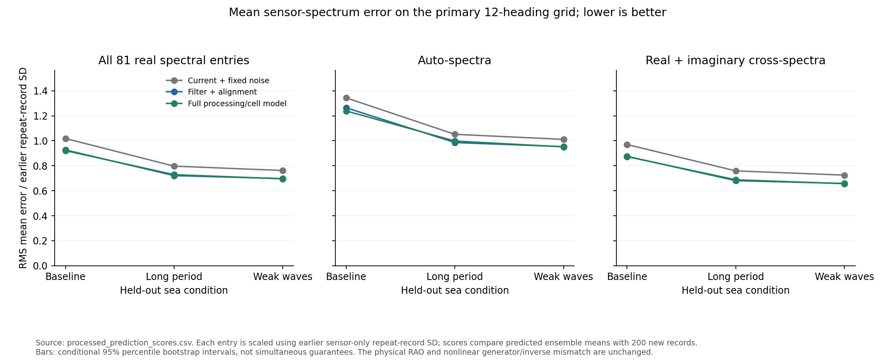
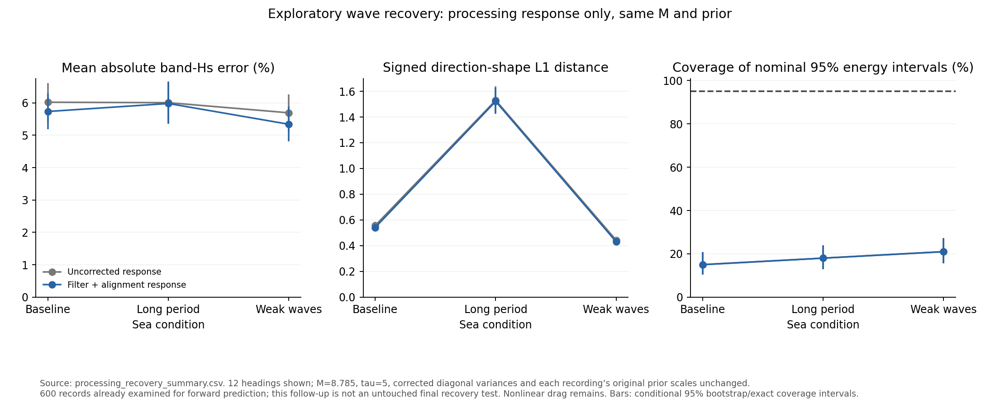

# Known processing: does it improve spectral prediction?

**Finding: known processing improves mean sensor-spectrum prediction, but the
full coupled model does not meet the prespecified practical target on the
primary 12-heading grid.** Most of that primary-grid gain is already obtained
by the simpler filter/time-alignment response. This is evidence of a useful
measurement correction, not proof of better wave recovery or calibrated
inverse uncertainty.

This follows the [mean-model audit](spectral_mean_audit.md). It is a frozen
comparison of predicted mean sensor spectra against **600 new native
recordings**, with nonlinear drag retained. It does not fit M, alter the
physical response, run an inverse or validate wave-recovery uncertainty.
The separate exploratory recovery follow-up below uses the same records
after the forward comparison, with its selection timing stated explicitly.

## Fresh-data results

Relative reductions in the primary RMS sensor-mean prediction error, full
processing/cell model versus the same current response with fixed noise:

- Baseline: **9.57%**, paired 95% interval **8.87--10.22%**.
- Long period: **8.53%**, interval **7.76--9.19%**.
- Weak waves: **8.75%**, interval **7.54--9.77%**.

All three intervals exclude no improvement. None of the primary-grid point
estimates reaches the prespecified 10% practical target. This is a modest
positive result, not a complete mean-model fix. Auto- and cross-spectral
family comparisons are saved separately; the primary conclusion does not
select a favourable family or frequency range.

The simpler filter/alignment response gives **8.99%, 9.51% and 8.50%**
reductions. These intervals also exclude zero. The full model therefore
adds little to this primary-grid comparison and has a smaller improvement
point estimate in the long-period case. These observations do not justify
adopting a much more complex inverse merely to reproduce the full model.

On the prespecified 36-heading sensitivity, full-model improvements are
**17.65% (13.84--20.64%), 20.06% (11.35--25.04%) and 19.30%
(10.70--24.67%)**. Those satisfy the practical mean-prediction criterion in
these tests. Finer directional representation does not automatically imply
better inverse recovery: its additional unknown powers remain poorly resolved.





## Does the simpler correction improve wave recovery?

This follow-up compares the current response with only the filter/alignment
response on the same 600 records: **2400 inversions**, two methods and two
direction grids. It is an exploratory development comparison, not an
untouched final recovery test. The filter/alignment candidate was defined
before these recordings, but selected for the inverse follow-up after the
forward results. A later adoption needs a fresh final test.

Both methods use M = 8.785033150237455, tau = 5 and the same corrected
diagonal marginal variances. Every recording's original prior scale is
computed once and held identical across the pair. Sensor-noise means are
not subtracted in either inverse. There is no change to drag, damping,
direction grid, physical RAO calculation or regularisation. This compares
two calibrated-variance research controls, not production M = 2.5 against
a new method.

On the primary 12-heading grid, mean absolute band-Hs errors are:

- Baseline: **6.020% to 5.734%**. Paired change **-0.286 percentage points**,
  95% interval **-0.436 to -0.140**.
- Long period: **6.006% to 5.981%**. Change **-0.025 points**, interval
  **-0.082 to +0.027**; an improvement is not resolved.
- Weak waves: **5.693% to 5.339%**. Change **-0.354 points**, interval
  **-0.488 to -0.213**.

These are small height improvements in two conditions, not a uniform
performance upgrade. Frequency-spectrum NRMSE slightly worsens in all three:
**33.286% to 33.574%, 34.202% to 34.299%, and 33.074% to 33.238%**.
All three paired deterioration intervals exclude zero.

Mean-direction absolute error rises **1.469 to 1.507 degrees** at baseline
and **2.103 to 2.213 degrees** in weak waves, with paired intervals excluding
zero. Its long-period change is unresolved. Conversely, signed directional
shape L1 improves slightly in all three conditions, as does the already
large negative-power fraction. Different summaries measure different aspects
of this ill-resolved directional spectrum.

Nominal 95% band-energy coverage is unchanged at **15%, 18% and 21%**.
This correction therefore does not repair uncertainty calibration. The
36-heading sensitivity has similar small height benefits, slightly worse
frequency spectra and mean-direction errors, and no coverage rescue.
All 2400 fits are retained; none fails with nonpositive total energy.



**Recommendation:** retain the correction as a research candidate, withhold
a general performance or uncertainty claim, and do not merge/regenerate on
these results alone. Known measurement processing is a justified part of the
model, but improving its forward mean does not guarantee every inverse
output improves under the remaining physical mismatch, diagonal covariance
and weak directional identifiability. M remains fixed; choosing another M
to hide these effects is not supported. Further work should target the
reported outputs and their correlated uncertainty, with model bias assessed
separately. The full window-coupled inverse has not been built or selected.

## What changed

The experimental observation operator maps unknown directional powers in
frequency cells to the expected 81 real spectral entries at each measured
frequency. It accounts for the known FIR filter, common-grid interpolation,
periodic Hann window, per-segment constant detrend and negative-frequency
leakage. These follow the operations in the actual reader and
[SciPy CSD convention](https://docs.scipy.org/doc/scipy-1.17.0/reference/generated/scipy.signal.csd.html).

Powers are represented as constant per hertz within each frequency cell.
There are 62 cells over the available hydrodynamic response range, including
guard cells outside the retained 0.05--0.31 Hz band. Guard powers are unknown
inputs, not a JONSWAP tail supplied to an inverse. The response calculation
uses the existing batch RAO interpolation, unchanged. The resulting matrix
has 4293 measured entries and 744 unknown powers for 12 headings, or 2232
for 36 headings. It couples nearby frequencies.

The operator is constructed from channel responses, frequencies, quadrature
and the known measurement process. It receives no generating wave family,
random phases, true powers, covariance, inverse output or recovery score.
For this **forward validation**, known ensemble powers are subsequently
supplied as test inputs. They are histogrammed into the same cells; they do
not fit the operator. These known-input checks are not blind wave recovery.

## Frozen controls and fresh data

Four predictions are fixed before the new recordings are generated:

1. Current bin-centre wave-only prediction.
2. The same prediction plus a fixed sensor-noise mean.
3. Filter and time-alignment response at the bin centres, plus that noise mean.
4. Full processing/cell prediction, plus the same noise mean.

The primary comparison is 4 versus 2. Method 3 isolates filtering/alignment;
the full model additionally changes frequency-cell integration, includes
unknown guard cells, and applies Welch averaging. Its effect must not be
attributed solely to the window. The fixed noise offset comes from the 64
earlier zero-wave sensor records, seeds 260000--260063, and is identical
across all noise-inclusive methods. Its estimation uncertainty is not
integrated into the conditional test intervals.

New seeds are 270000--270199 (baseline), 271000--271199 (long period) and
272000--272199 (weak waves). None overlaps earlier calibration, resolution,
inverse, covariance or mean-audit records. The primary direction grid is
Will's 12-heading batch default; 36 headings is a prespecified sensitivity
check. The generator retains 36 directions and 6400 uniform wave components,
40 BEM frequencies, the 90 m hull at 15 m depth and zero speed, nonlinear
drag, radiation memory, controller and the original sensor errors. Each run
lasts 1200 s; processing discards 300 s and retains 1800 samples at 2 Hz.

M = 8.785033150237455 and tau = 5 remain recorded and unchanged. **Neither
is used in these forward predictions.** This deliberately isolates the mean
model from variance weighting and regularisation. No physical coefficient,
M(f), prior strength or empirical mean offset is fitted to the new records.

## Performance measure and confidence

For each condition, compare the predicted mean with the mean of its 200 new
spectral records. Scale every real entry by its repeat-record standard
deviation from the earlier 200 sensor-only records in that condition. This
puts pressure, angle and acceleration entries on comparable scales. These
units are evaluation normalisation, not an oracle pool selector in an inverse.

The primary score is the RMS of these standardised mean discrepancies across
all 4293 entries. Lower is better. Auto-spectra and cross-spectra are also
reported separately. The practical target was fixed before testing: at least
10% lower primary error, with a paired 95% interval excluding no improvement.
All conditions and both grids remain visible even when the criterion fails.

Intervals use 1000 paired whole-record bootstrap resamples of the fresh
recordings. They preserve dependence across channels and frequencies and are
conditional on the frozen predictions, calibration units and noise offset.
They are pointwise intervals, not simultaneous or physical-model guarantees.
RMS/percentage statistics can have finite-bootstrap bias near zero; a good
mean score is not proof of calibrated posterior uncertainty or every local
spectral entry.

## Verification and reproduction

The 16-point cell quadrature is checked against 32 points before any fresh
outcomes. The standardised operator difference is 6.93e-6 on both heading
grids (about 0.00069%). Independent time-domain harmonic CSDs check the matrix
normalisation, phase convention, cell widths and linearity. Invalid operator
inputs are rejected. A deliberately worse validation fixture remains a
reported deterioration and cannot cause refitting. All 45 tests pass,
including separate direct-Gaussian and unresolved-prior checks of the
fixed-prior inverse solver. Its original-response results agree with the
existing inverse within relative 2e-6 for the first record of each case/grid.

```sh
python WM/check_processed_prediction.py --generate --workers 2
python WM/check_processed_prediction.py
python WM/plot_processed_prediction.py
python WM/check_processing_recovery.py
python WM/plot_processed_prediction.py
python -m unittest discover -s WM -p 'test_*.py' -v
```

The protocol and prediction hashes are frozen before generation. Source,
scores, changes, curves and figures belong on the exploration branch; raw
records and prediction arrays remain ignored. Production sources, main,
Drive data and report files remain unchanged. Shared generator/inverse
physics, the linear-response/nonlinear-drag discrepancy, coarse directions,
within-cell assumptions and interior-processing approximations remain.
