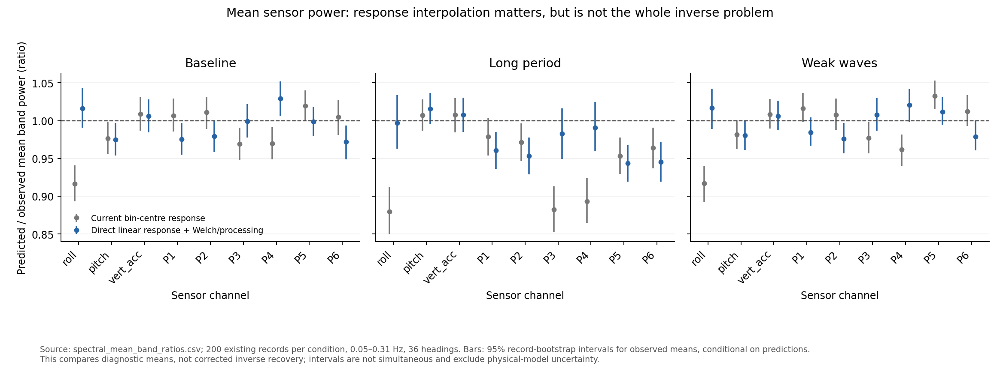
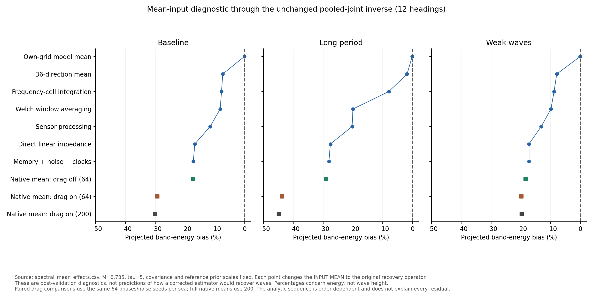

# What the variance evidence supports

**The scalar M now has a defensible sensor-level calibration for the tested
6400-component generator. The current inverse uncertainty does not.** These
are different conclusions: a variance estimate can describe fluctuations
around the observed mean correctly while the inverse predicts the wrong mean
or omits important correlations. Poor posterior coverage does not, by itself,
invalidate the sensor-only calibration or justify choosing another M.

This audit keeps M = 8.785033150237455, tau = 5, all existing calibration
matrices, main, production sources, Drive data and the report unchanged.
It diagnoses the mean model; it does not implement or validate a correction.

## Three spectral quantities, with different jobs

- **Shat:** the Welch spectral matrix computed from one finite, noisy,
  processed sensor recording. A different recording gives a different Shat.
- **C:** its ensemble mean for the same measurement process and conditions.
  It includes sensor-noise power, processing and spectral-window averaging.
  Repeat-record variance describes fluctuations around this mean.
- **S_model(x):** the wave-only spectrum predicted by the current transfer
  functions and directional powers. The code uses a response at each Welch
  frequency and direction-bin centre. It implicitly treats this prediction
  as the mean of the observed spectral data.

The Wishart variance identities concern the noise-inclusive sensor spectrum,
under their Gaussian/stationary averaging assumptions. They do not make a
misspecified wave response equal to C. In particular, increasing M can make
the likelihood more confident about an incorrect mean.

In an ideal linear measurement model, the expected observed spectrum would
include the channel response, the measurement filters, sensor-noise power
and Welch averaging. That expectation generally mixes nearby frequencies;
it is not exactly the unsmoothed wave-only spectrum at one bin centre.
[SciPy's CSD documentation](https://docs.scipy.org/doc/scipy/reference/generated/scipy.signal.csd.html)
specifies the conjugation, normalisation, per-segment detrending and window
operation. [Its decimation documentation](https://docs.scipy.org/doc/scipy/reference/generated/scipy.signal.decimate.html)
specifies the anti-alias filter and delay compensation. Zero phase does not
mean unit amplitude response, and later interpolation can also change both
relative amplitudes and phases.

## What the earlier investigations established

**Wave-component resolution is supported within a stated scope.** The
[uniform-grid comparison](frequency_grid_choice.md) supports 6400 components
as a conservative working reference for pooled full-band spectral variances,
with 40 BEM response frequencies held fixed. It does not establish convergence
of every entry, BEM accuracy or physical validity. Neither 6400 nor 40 should
be presented as a universally sufficient resolution.

**M = 8.785 is a backed marginal-variance scale for that generator.** The
[sensor-only calibration](m_calibration.md) used 200 baseline training records,
with a 95% bootstrap interval of 8.602--8.991. Independent baseline, long-period
and weak-wave records supported auto-spectral variance calibration. No inverse
or true wave powers selected M. This is a conditional empirical result for
the specified hull, sensor/noise model, grids and recording settings.

**M is not the number of Welch segments.** There are eight segments here.
For the implemented estimated-auto numerator, the approximate Wishart
count is L = M - 1 = 7.785. A locally flat Gaussian calculation for an
overlapped periodic Hann gives L = 7.629 and hence plug-in M = 8.629, inside
the empirical interval. This independently supports the scale's plausibility,
not exact Wishart behaviour of coloured nonlinear records. Repeat-seed
calibration also includes the sensor errors/calibration draws varied by this
simulator; it is not a pure count of independent wave observations.

**The corrected cross-variance formula has mathematical and held-out support.**
The [finite-average, coherence-aware correction](cross_variance.md) preserves
the calibrated auto weights and permits unequal real/imaginary variances.
On 600 additional records, median entrywise cross-variance error factors
fell from 1.38--1.49 to 1.07--1.08. The usual marginal formula includes the
phase-dependent cross term; see [Ingram (2019), section 2.3](https://arxiv.org/html/1909.01385v1#S2.SS3).
The finite plug-in correction is derived and tested in this repository.
These are marginal moments, not a full independent-entry likelihood or a
proof that all local variances or distribution tails are calibrated.

**Diagonal Sigma is inadequate for the tested inverse uncertainties.** The
[frozen inverse check](inverse_recovery.md) found nominal 95% energy coverage
of only 16.5--26% with the corrected variances. Sensor-only fixed-gain
diagnostics found within-frequency correlations multiplied propagated
band-energy variance by about 24--35, with frequency correlations adding
another factor of about 1.8--1.9. These factors concern that functional and
experiment; they are not global uncertainty multipliers.

**Our joint covariance constructions are research candidates, not validated
solutions.** Both the [same-record construction](correlated_covariance.md)
and [independent pooling](pooled_covariance.md) failed recovery/coverage
checks. Pooling slightly helped diagonal weighting but did not rescue the
joint inverse. Estimated shrinkage has a statistical rationale; the chosen
frequency coupling, calibration-pool representativeness and resulting
posterior are not thereby validated. More calibration records do not reduce
the variability of a new recording by the pool size.

## What remains unjustified or provisional

- **M = 2.5 as a generally calibrated choice:** the tested evidence does not
  support it. For the original 40-component generator, the separate baseline
  auto-calibration was 3.748, interval 3.611--4.059, with much larger local
  discrepancies. Neither this nor 8.785 verifies the historical Drive ZIP.
- **M(f):** no present evidence requires this extra function. A noisy estimate
  per frequency can overfit calibration fluctuations, and it cannot repair
  omitted correlations, a wrong mean or directional non-identifiability.
- **tau = 5 and the directional prior:** explicitly chosen regularisation,
  not calibrated physical variability. The mean diagnostic rules out prior
  shrinkage as the main integrated-energy bias in this experiment; it does
  not validate directional uncertainty or resolve negative directional powers.
- **Exact Gaussian/Wishart behaviour and full joint covariance:** useful
  approximations, with strong support for certain marginal second moments.
  Their tail behaviour and complete dependence structure are unvalidated.
- **Viscous damping, drag coefficients and sensor-error settings as real-hull
  measurements:** model assumptions unless independently documented or
  measured. Hull dimensions fixed by the problem are inputs, not parameters
  estimated by M. Synthetic repeatability cannot establish their physical
  accuracy or transfer to different settings.

## Mean-model audit: what is actually missing

We used the 600 existing pooled-study sensor records (200 per condition).
This is an exploratory post-validation audit, not a new held-out recovery
test. Known wave spectra are used only to calculate diagnostic expected
means and scoring targets. They never fit M, A, covariance or the prior.

Controlled sinusoid tests confirm the cross-spectrum sign and one-sided
normalisation. With the generator's negative-time phasors, SciPy's
conjugate-FFT-first convention is consistent with h_c conjugate(h_k).
The contrary comment in welch_matrix is misleading; the tested operation
itself is consistent. This is not an explanation for the recovery failure.

We then changed the diagnostic input mean through a sequence of operations,
always applying the *unchanged* pooled-joint recovery operator, with prior
scales frozen at an independent calibration mean:

1. Use 36 generation directions rather than grouping them onto 12 centres.
2. Integrate component energies/responses within frequency cells.
3. Apply the exact periodic-Hann expected harmonic CSD, including the
   per-segment constant detrend and the small negative-frequency term.
4. Include the interior FIR and common-grid linear-interpolation response.
5. Interpolate hydrodynamic coefficients and solve the linear impedance at
   the requested frequency, instead of interpolating the already-solved RAO.
6. Compare with the continuous, truncated radiation-memory model; add an
   independently simulated sensor-noise mean and expected clock attenuation.

This is a mechanism audit, not an estimator that knows the true wave spectrum.
The stages are order dependent; their differences are not unique causal
allocations of all observed error. Finite boundaries, startup, RK4 memory
stage handling and some sensor effects remain approximations.

The response interpolation is consequential. For roll, current 36-heading
bin-centre predicted/observed band-power ratios are 0.917, 0.880 and 0.917;
their 95% intervals exclude one. Including processing and directly solving
the interpolated linear impedance gives 1.016, 0.997 and 1.017; their
intervals include one. This improves that sensor-mean comparison, while
other channels retain discrepancies. It does not validate corrected inverse
recovery or convergence of the 40-point hydrodynamic coefficients.



For the original 12-heading recovery operator, its own mean gives only
about 0.1% prior energy shrinkage. The successive diagnostic mean inputs
produce approximately:

- Baseline: -7.35% after the direction-grid change, -8.21% with Welch
  averaging, -11.57% with sensor processing, and -17.24% with the final
  linear dynamics/noise/clock diagnostic. The observed mean gives -30.05%.
- Long period: -1.85%, -20.01%, -20.28% and -28.07%, against -44.92% observed.
- Weak waves: -7.97%, -9.91%, -13.18% and -17.26%, against -19.69% observed.

These percentages are **band energy**, not wave-height error and not the
percentage error in every sensor spectrum. The unchanged inverse amplifies
small structured mean discrepancies. Its 36-heading sensitivity also has
substantial bias, so merely adding directional unknowns is not a solution.



### Paired test of quadratic drag

The time generator contains quadratic translational drag; the frequency-domain
RAO includes viscous roll/pitch damping and the controller but omits this
amplitude-dependent translational drag. To isolate its effect, we generated
192 diagnostic records: the first 64 existing seeds in each condition, with
the same waves/noise and only this drag term switched off. Original drag-on
replays for the first seed of each condition reproduce the saved spectra
exactly. Production drag was not removed or changed.

Through the same fixed 12-heading recovery operator, drag-off minus drag-on
band-energy projections are:

- Baseline: **+12.02 percentage points**, paired 95% interval **11.11--12.95**.
- Long period: **+14.70**, interval **13.65--15.73**.
- Weak waves: **+1.37**, interval **1.24--1.50**.

The 36-heading differences are +11.38, +14.52 and +1.25 points, also with
intervals excluding zero. This is controlled evidence that omitted drag
contributes to the mean discrepancy in the tested simulator. It is not a
newly fitted drag coefficient or independent physical validation.

The final analytic linear-mean projections are within about 1.2 energy
percentage points of the 64-record drag-off means on both grids. That is a
descriptive diagnostic agreement, not a prespecified equivalence result.
Agreement of this one projection is not closure of the full sensor-mean
matrix or a test of a corrected estimator.
The noise-only calculation uses 64 separate zero-wave sensor runs, seeds
260000--260063. Noise and clock effects matter conceptually but do not
explain the large height/energy bias here.

## The best next step for defensible uncertainty

**Keep M fixed as a sensor-level result; stop using it as an inverse repair
parameter.** For this data configuration, the remaining task is to make the
observation model and propagated uncertainty defensible together.

1. Build and independently check a measurement-aware mean operator on the
   exploration branch: known filtering/interpolation, finite-window spectral
   averaging, explicit frequency/direction-cell meaning, and a physically
   justified off-grid response calculation. Check hydrodynamic-response
   resolution separately from wave-component resolution. Unknown powers,
   including any needed guard-band power, must remain unknown; do not give
   the inverse the generating JONSWAP shape or directional distribution.
2. Treat nonlinear drag/model discrepancy explicitly. Use physical modelling
   or independent sensor/response calibration to justify a correction or a
   stated validity range. Do not copy the generator's truncated numerical
   kernel into the inverse, remove realistic drag to make validation pass,
   or fit a mean offset against true wave powers.
3. Freeze that proposal before fresh testing. First test its sensor mean;
   then evaluate covariance predictions, wave recovery and uncertainty
   together, keeping M/tau fixed for attribution. Use disjoint development
   and final-test records and include difficult conditions and failures.
   The failed covariance constructions remain controls, not accepted defaults.
4. Validate uncertainty for the actual reported quantities (band energy,
   Hs, frequency spectrum and directional summaries). Empirical sensor
   covariance propagated through a frozen estimator is a useful separate
   check, without requiring inversion of a huge sample covariance. Sampling
   variance and systematic bias need separate assessment; a wider interval
   alone does not validate the method.
5. Revisit scalar M versus M(f) only if fresh sensor-level evidence finds
   repeatable, practically important frequency dependence after the corrected
   variance formula. Refitting is required when the generator or processing
   changes materially. A mean-operator-only change does not itself invalidate
   the previous measurement-based marginal calibration.

This is the shortest justified route back to the main objective. We have
already made the marginal variance parameter more defensible. The missing
step is not another scalar: it is establishing what the estimator is taking
the variance *around*, and how correlated errors reach its reported outputs.

## Reproducibility, provenance and limits

All comparisons use main at caaaf415dbe7bd372187758fe542c69999913d3e: 90 m
hull, radius 5.36 m, depth 15 m, zero speed, 6400 uniform wave components,
40 BEM frequencies, 36 generation directions, native 1200 s simulations,
300 s discard, 2 Hz processing and 200 s Hann segments with 50% overlap.
Only Hs/Tp change in the three conditions. Sensor settings and existing
shared generator/inverse physics remain. No Drive-provenance claim follows.

The audit follows Will's batch RAO builder, as did the recovery studies.
The standalone load_rao path is older: it refers to absent submarine.OMEGAS
and omits the batch viscous-damping term. Existing production RAO caches also
lack complete source fingerprints. Those paths were not used here; this
finding should be resolved before claiming equivalent results across entry
points or historical caches. The research loads a source-checked hydrodynamic
cache and rebuilds the batch RAOs in temporary directories.

Run with the simulation dependencies in convergence_environment.json:

```sh
python WM/audit_spectral_mean.py
python WM/plot_spectral_mean_audit.py
python -m unittest discover -s WM -p 'test_*.py' -v
```

CSV outputs retain per-channel mean ratios, frequency curves, all diagnostic
energy projections, paired drag effects and bootstrap intervals. The manifest
records source and input hashes, seeds and scope. Raw noise/drag-off records
remain ignored. Tests independently check the harmonic expectation and sign,
normalisation, and FIR/interpolation response against the actual reader.
Bootstrap intervals resample whole paired records; they are conditional,
pointwise intervals, not simultaneous confidence or physical-model bounds.
No corrected estimator has been validated or adopted by this audit.
All 39 tests pass. Final checks retain all 600 original, 192 paired drag-off
and 64 noise-only records; verify the 66 mean-input energy diagnostics and
189 sensor band-power ratios; and confirm unchanged production/report hashes.
