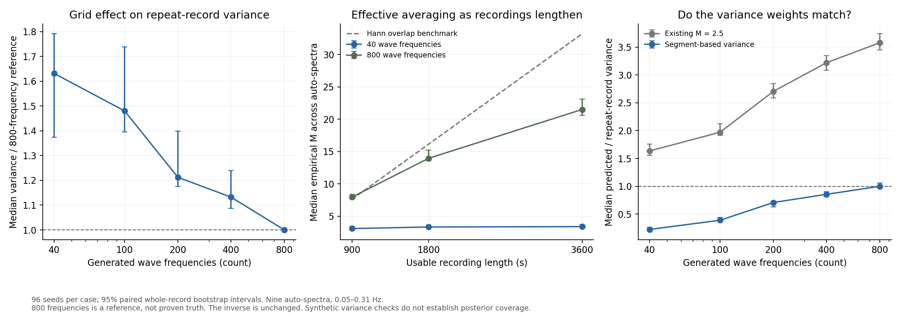
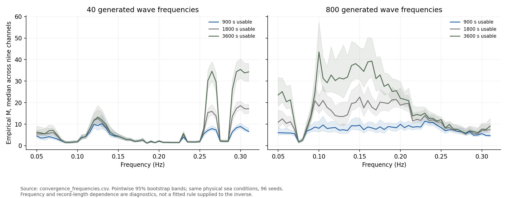

# Wave-grid convergence and effective averaging

Follow-up: [refinement through 3200 frequencies](variance_resolution.md)
checks the remaining resolution issue before calibrating M.

## Finding

The current simulated sea does not support interpreting M as the number of
independent Welch segments. The variance-equivalent M changes with wave-grid
density, frequency and recording length. Increasing the wave grid helps, but
800 wave frequencies has not demonstrated convergence within the pre-set 10%
tolerance. The inverse and its M = 2.5 weights remain unchanged.



## Experiment

The protocol was saved before evaluating the simulations. Wave-frequency counts
were 40, 100, 200, 400 and 800. The 900 s usable record was tested at every count;
1800 and 3600 s were also tested at 40 and 800 frequencies. There were 96 fresh
seeds, 104000--104095, per setting.

This required 480 full simulations and produced 864 spectral records. Length
comparisons use nested prefixes of the same long preprocessed recording.
The seeds are paired across settings, so 864 is not a count of independent
realisations. Bootstrap resampling preserves these pairings.

Fixed settings: 90 m capsule, radius 5.36 m, depth 15 m, zero forward speed,
Hs = 1.7 m, Tp = 8 s, gamma = 3.3, spreading s = 10, direction pi/2, 36 generation
headings. The original controller, radiation memory, nonlinear drag, sensor
errors and preprocessing were retained. The first 300 s were discarded. Welch
uses 200 s periodic-Hann segments at 2 Hz with 50% overlap. The hydrodynamic
response grid was held at 40 frequencies to isolate wave-synthesis resolution.

The data generator uses the equations on main at
`caaaf415dbe7bd372187758fe542c69999913d3e`. For speed, deterministic forcing and
pressure sums are cached and the Gaussian recurrence uses an equivalent filter.
Their values are checked against the original expressions. No wave parameters,
phases or response functions are passed to the variance estimators.

## Evidence about M

Empirical M for an auto-spectrum is its ensemble mean squared divided by its
variance between recordings. The summaries below take the median across the
nine auto-spectra and 0.05--0.31 Hz. These are diagnostics, not fitted parameters
passed to the inverse.

- At 900 s, median empirical M rises through approximately 3.10, 3.94, 5.78,
  7.07 and 7.96 as the wave count rises from 40 to 800.
- At 40 wave frequencies, increasing usable time from 900 to 3600 s changes
  median M only from 3.10 (95% interval 2.89--3.40) to 3.40 (3.21--3.72).
  The median variance ratio is 0.955 (0.938--0.969): roughly a 5% reduction
  despite four times as much data. The median mean-spectrum ratio is 0.9995
  (0.9984--1.0005), so the aggregate mean is stable over this comparison.
- At 800 frequencies, the corresponding M values are 7.96 (7.66--8.36),
  13.96 (13.59--15.21) and 21.51 (20.62--23.11) for 900, 1800 and 3600 s.
  The 3600-to-900 variance ratio is 0.395 (0.377--0.436), a reduction of about
  60%. The Hann overlap benchmark predicts a ratio near 0.230, or 77% reduction.

These results support the concern that the coarse finite-component sea limits
the additional information obtained by observing it for longer. They do not
prove that this is the only effect, or that a particular M applies to real seas.
Empirical M can also exceed a nominal segment count under this fixed-amplitude
wave construction; it is a variance-equivalent diagnostic, not a literal count.

The existing code squares the estimated auto-spectrum in each recording when
forming its variance numerator. That numerator itself varies between records.
Consequently the empirical M above is not a direct replacement for the input M
in the code. `convergence_methods.csv` evaluates the actual plug-in formulas.

## Has the wave grid converged?

Not within the declared criterion. At 900 s, the median variance at 400
frequencies is 1.132 times that at 800, with a 95% interval of 1.087--1.239.
The median mean-spectrum ratio is close to one, but this hides variation across
individual channels and frequencies.

Only 8.8% of individual mean-spectrum comparison intervals fit wholly inside
the 10% band, and none of the variance comparison intervals did. This does not
prove every variance differs by more than 10%; many intervals are too wide to
establish agreement that precisely. More seeds would tighten Monte Carlo
uncertainty; a denser reference would test whether the endpoint is stable.

800 frequencies is only the finest tested reference. Its ratios of one and
zero-width comparison intervals are identities, not convergence evidence.
The summary CSV marks those rows with `reference_identity=True`.

## Does the recording-derived variance method work?

At 900 s, its median predicted-to-observed variance ratio rises from 0.224
(0.215--0.263) at 40 frequencies to 1.000 (0.970--1.061) at 800 frequencies.
However, at 800 frequencies it falls to 0.876 (0.834--0.937) for 1800 s and
0.674 (0.626--0.701) for 3600 s. At 40 frequencies and 3600 s it is only 0.051
(0.049--0.060). The method is therefore not a reliable drop-in replacement.

The fixed-M formula is not universal either. With 800 frequencies its median
predicted-to-observed variance ratio is 3.58 at 900 s and 9.00 at 3600 s.
These marginal variance checks do not establish how the final posterior behaves.



## Confidence and scope

Intervals use 1000 paired whole-record percentile bootstrap resamples. Individual
frequency intervals are pointwise, not simultaneous bands. The 10% tolerance was
specified before results were evaluated. Frequency bins and channels were not
treated as independent observations. See `convergence_protocol.json` and
`convergence_environment.json` for settings and library versions.

Only one hull, depth, sea spectrum and noise configuration was tested here.
The hydrodynamic grid and time step were fixed; their numerical convergence was
not assessed. The original high-frequency mesh warning remains. No real data,
independent hydrodynamic validation, inverse recovery, or posterior coverage was
tested. Source fingerprint and finite-value checks passed for all saved records.

## Decision

Keep the inverse unchanged. Do not compensate for the coarse simulated sea by
fitting a truth-dependent M(f). First extend the wave-grid reference and sample
size until the simulated observation statistics are demonstrably stable at the
longest recording length. Then validate a measurement-based uncertainty rule on
an independently implemented response model, with known hull geometry aligned,
before considering a change to production weights.

## Reproduction

Generation requires the normal model dependencies, including Capytaine, xarray,
NumPy, SciPy and Matplotlib. Analysis requires NumPy, SciPy and Matplotlib.

```sh
OPENBLAS_NUM_THREADS=1 OMP_NUM_THREADS=1 python WM/variance_convergence.py --generate --workers 2
OPENBLAS_NUM_THREADS=1 python WM/analyse_variance_convergence.py
python -m unittest discover -s WM -p test_spectral_variance.py -v
```

Generation resumes from completed spectral records in the ignored
`variance_output/convergence` folder. A different protocol or model fingerprint
is rejected. Full recordings and hydrodynamic caches are not committed.
The result CSVs include all individual auto-spectral means, variances, M values,
comparison ratios and confidence intervals, rather than just the plot summaries.
