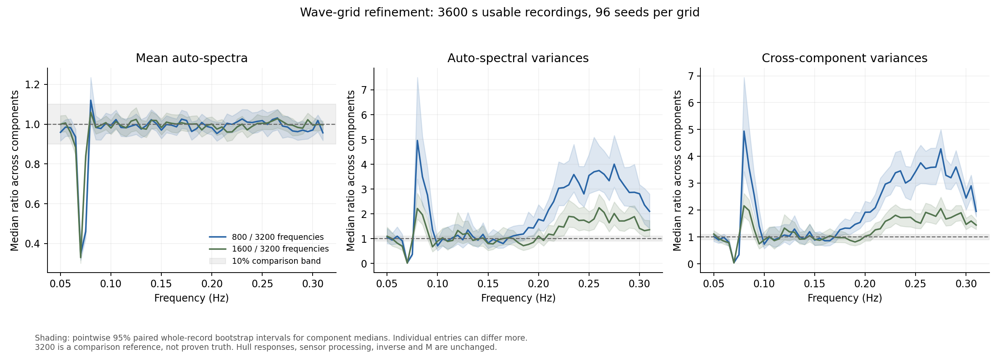

# Wave-frequency resolution before calibrating M

Follow-up: [uniform frequency placement and refinement](variance_uniform.md)
tests the proposed alternative grid with the same sea spectrum and energy.

This experiment asks whether the sensor spectra stop changing as the generated
wave-frequency grid is refined. It does not select M or fit the inverse.

**Result: stability across the full frequency band is still not established.**
The 1600-to-3200 refinement leaves clear variance differences in the hour-long
recordings, especially in the upper tail, and a mean-spectrum discrepancy near
0.07 Hz. We should resolve these effects before calibrating M.

## Findings

For 3600-second usable recordings, comparing 1600 / 3200 wave frequencies:

- The whole-band median auto-spectral mean ratio is 0.996 (95% bootstrap
  interval 0.987--1.001). However, the channel-median ratio at 0.07 Hz is only
  0.329. Most mean spectra agree much better than that one region; the overall
  median conceals it. Relative differences can be large in low-power regions.
- The median auto-spectral variance ratio is 1.145 (1.115--1.239). The coarser
  grid therefore still gives about 14.5% higher variance at the median entry;
  this aggregate interval lies beyond the 10% comparison band.
- The corresponding cross-component variance ratio is 1.186 (1.162--1.249).
  The effect is also present in the cross-spectra used by the inverse.
- In the 0.26--0.31 Hz tail, the median auto-spectral variance ratio is 1.813
  (1.594--1.928), and the cross-component ratio is 1.765 (1.636--1.852).
  These differences are substantially larger than their Monte Carlo intervals.

The recording length matters. At 900 seconds the whole-band median
auto-spectral variance ratio for 1600 / 3200 is 0.959 (0.917--1.016), inside
the 10% band at this aggregate level. This does not establish agreement for
every entry, and it does not transfer to the hour-long recording.

Adjacent-grid agreement is more informative than comparing every setting to
the finest grid alone. Medians of ratios also do not multiply: the median
800/3200 ratio need not equal the product of the two adjacent-grid medians.

## Recommended next check

Test a frequency grid with more even coverage across the retained band,
holding the sea spectrum, total energy, hull and sensor model fixed. Choose
its spacing from the recording duration and a further refinement check,
without looking at inverse recovery or trying to obtain a preferred M.
This is a proposed diagnostic, not an implemented generator change.

The reason is concrete: main uses equal-energy frequency bins. At 3200
frequencies, 2364 components fall in 0.10--0.16 Hz, but only 69 fall in
0.26--0.31 Hz. The lowest generated frequency moves from 0.08133 Hz at 800
to 0.07773 Hz at 3200. These changing gaps and spectral leakage are plausible
contributors to the observed edge effects; this experiment does not isolate
them as the only cause. A controlled alternative grid would test that
explanation more directly than repeatedly doubling the same grid everywhere.

Once numerical stability is demonstrated, freeze that generator and use
fresh seeds to investigate the variance model and M. Keep calibration and
later evaluation records separate. These resolution results do not select
M = 2.5, another scalar M, or M(f).

## Experiment

We compared 800, 1600 and 3200 generated wave frequencies using 96 seeds
(104000--104095) at each grid. Usable recording lengths were 900, 1800 and
3600 seconds. The 800-frequency records were reused from the previous study,
with their hashes retained locally; 192 new full simulations supplied the
1600- and 3200-frequency results. The three lengths are nested prefixes of
each long preprocessed recording: 864 spectral records are not 864 independent
realisations.

The source remains main at `caaaf415dbe7bd372187758fe542c69999913d3e`:
90 m capsule, radius 5.36 m, depth 15 m, zero speed, Hs 1.7 m, Tp 8 s,
gamma 3.3, spreading s = 10, direction pi/2 and 36 generation directions.
The controller, nonlinear drag, radiation memory, sensor errors, initial
300-second discard and preprocessing are unchanged. Welch uses 200-second
Hann segments at 2 Hz with 50% overlap. The BEM response grid stays at 40
frequencies, so this isolates wave synthesis rather than hydrodynamic accuracy.

The protocol was saved before generating the new records. No grid is selected
using inverse recovery error or a preferred M. The existing inverse and its
M = 2.5 baseline are unchanged; this does not justify 2.5 for the final model.

## What the comparisons measure

For each channel and frequency, we measure the ensemble mean auto-spectrum
and its variance between recordings. We also compare the variances of all
72 real/imaginary cross-spectrum components, covering all 81 real observations
used by the inverse. Ratios use the coarser grid divided by the finer grid.
Both adjacent refinements and the 800-to-3200 comparison are retained.

The 10% comparison band is the same as the previous experiment. We resample
whole seed records together across grids and recording lengths, with 1000
bootstrap draws. Seed labels are paired; changing the frequency grid does not
produce identical realised waves. Channel and frequency correlations are
preserved in the aggregate bootstrap summaries.

`resolution_summary.csv` gives whole-band and four sub-band results. It reports
the median ratio and its 95% interval, the 90th percentile of absolute relative
differences, and fractions of individual comparisons whose intervals are
wholly inside or wholly outside the 10% band. Intervals that overlap a boundary
are inconclusive. A median near one alone does not establish convergence.
`resolution_frequencies.csv` retains the individual comparisons.



## Confidence and limits

3200 is the finest tested comparison, not a known continuum solution. The
bootstrap intervals describe Monte Carlo uncertainty for this simulated
condition. Individual intervals and plotted frequency bands are pointwise,
not simultaneous guarantees over the full spectrum. With 96 seeds, some
comparisons may remain too imprecise to establish agreement within 10%.

The checks use newly simulated records, not the existing Drive ZIP. They test
one sea condition and the inherited sensor/noise model. They do not validate
the physical hull responses, other sea states, posterior coverage, or either
a fixed M or M(f). The report and production generator/inverse remain unchanged.

## Reproduce

From the repository root, using the environment recorded in
`convergence_environment.json`:

```sh
python WM/variance_resolution.py --workers 2
python WM/analyse_variance_resolution.py
python -m unittest discover -s WM -p test_spectral_variance.py -v
```

The previous `variance_output/convergence` records and hydrodynamic cache must
exist first; generate them with `variance_convergence.py --generate` if needed.
Raw spectral checkpoints and large deterministic time carriers stay under the
ignored `variance_output/resolution` folder. Completed seeds are reused on
restart. Grouped forcing/pressure sums are evaluated in bounded blocks without
changing their equations. A full 3200-frequency simulation was checked against
the earlier calculation at all three lengths; original-equation checks and
the automated tests also pass.
