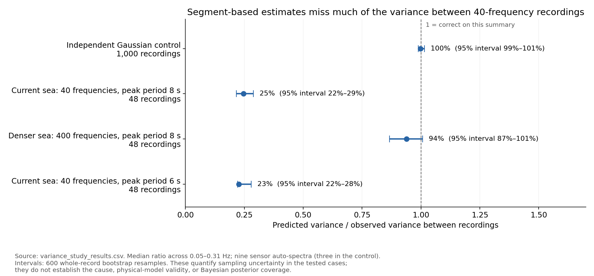

# Spectral variance study

The question is whether the uncertainty in a Welch spectrum can be estimated
from the recording itself, without choosing M using the true sea state.
This branch adds an experiment; it does not change the inverse or M = 2.5.

The larger [wave-grid and recording-length study](variance_convergence.md)
reports the subsequent 96-seed convergence checks.

## What was compared

- `fixed_2.5`: the existing plug-in variance formulas.
- `overlap_count`: those formulas with the Hann overlap correction, giving
  about 7.63 effective averages for the eight segments in a 900 s recording.
- `segment_variance`: variation between individual segment spectra, corrected
  for overlap and for centring on their sample mean.
- `nonoverlap_segments`: variation between four disjoint segments, scaled to
  predict the variance of the original overlapping Welch average.

Every method receives only the processed sensor samples and known recording
settings. There are no fitted coefficients. True wave parameters, phases and
response functions are unavailable to the variance estimators. Parameters in
CSV datasets are used only to check that repeated recordings belong together.

The observed target is the variance of the averaged spectrum across repeated
recordings under the same conditions. This is not sensor noise alone: it also
includes variability between wave realisations.

## Results

`variance_study_results.csv` contains the numerical results. A ratio of one
means the average predicted variance equals the observed repeat-record variance.
Summary ratios are medians across the nine auto-spectra and frequencies in the
stated band. They do not establish joint covariance or posterior coverage.



The graph above shows this experiment directly. The earlier effective-M curves
describe a different diagnostic and do not show how well segment-based variance
prediction works.

For the segment-based method over the full 0.05--0.31 Hz band:

- Independent correlated Gaussian control: ratio 1.00, 95% interval 0.99--1.01.
- Current 40-frequency sea, Tp = 8 s: 0.25, interval 0.22--0.29.
- Denser 400-frequency sea, Tp = 8 s: 0.94, interval 0.87--1.01.
- Current 40-frequency sea, Tp = 6 s: 0.23, interval 0.22--0.28.

The existing fixed-M weights gave a full-band median ratio of 1.62 in the
baseline case. Replacing them with the segment-based estimate would therefore
make the assumed uncertainty substantially too small in that experiment.

The control supports the estimator for the tested continuous-spectrum Gaussian
process. In the 40-frequency sea, variation between segments misses much of the
variation between independent realisations. The denser wave grid reduces this
discrepancy. This is consistent with limited frequency components providing too
little independent information within a recording. Fixed phases alone are not
an explanation: harmonic wave representations normally retain their phases.
Two wave-grid densities do not establish convergence or exclude other effects.

## Conditions and uncertainty

The hull cases use the 90 m capsule, radius 5.36 m, depth 15 m, stationary,
with the controller, nonlinear drag, radiation memory and sensor errors from
main at `caaaf415dbe7bd372187758fe542c69999913d3e`. Hs = 1.7 m,
gamma = 3.3, spreading s = 10, mean direction = pi/2, and 36 generation headings.
Each record is 1200 s long; the first 300 s are discarded, leaving 1800 samples
at 2 Hz. Welch uses 200 s Hann segments with 50% overlap.

There are 48 fresh recordings per hull case, seeds 93000--93047. The denser-grid
case changes the wave synthesis to 400 frequencies while retaining the same
40-frequency hydrodynamic response grid. The Gaussian control has 1000
independent three-channel AR(1) recordings with coefficient 0.8.

Intervals are approximate 95% percentile bootstrap intervals from 600 resamples
of whole recordings. Frequency bins and channels are kept together during
resampling; they are not counted as independent trials. The intervals describe
sampling uncertainty within each tested case, not uncertainty about ocean
physics. Individual-frequency errors can be larger than the median suggests.

Hull records were generated with the existing equations, caching deterministic
forcing and pressure sums. The cached formulas were checked against the original
expressions; the in-memory preprocessing was checked against the CSV route.
The original generator emits a mesh-resolution warning above about 1.90 rad/s;
that numerical limitation remains in these data.

Changing random seeds alone does not avoid inverse crimes. This study tests
variance estimates, not inverse recovery. An independent Gaussian control is
not an independent validation of the submarine model. No real-vessel records,
other hulls, or posterior credible-interval coverage were tested.

## Running it

From the repository root, with NumPy and SciPy installed:

The plotting command also requires Matplotlib.

```sh
python -m unittest discover -s WM -p test_spectral_variance.py -v
python WM/variance_study.py --control --out variance_output/control.csv
python WM/variance_study.py --root /path/to/repeated/sensor/data --out variance_output/hull.csv
python WM/plot_variance_study.py
```

The input can be native per-run sensor CSV folders, grouped under a folder for
each parameter combination, or preprocessed NPZ files containing a time-by-channel
array `X` at 2 Hz. NPZ files sharing a parent folder must represent the same
conditions. For the hull benchmark, the only changes to the baseline conditions
above are `n_freq=400` or `Tp=6`; use `sensors.create_sensor_data` to generate
repeated CSV runs with the listed seeds. Raw recordings and hydrodynamic caches
are not committed.

## Decision

Keep the production inverse and its weights unchanged. The
[convergence results](variance_convergence.md) support this decision and explain
the remaining resolution and uncertainty checks before any replacement is used.
