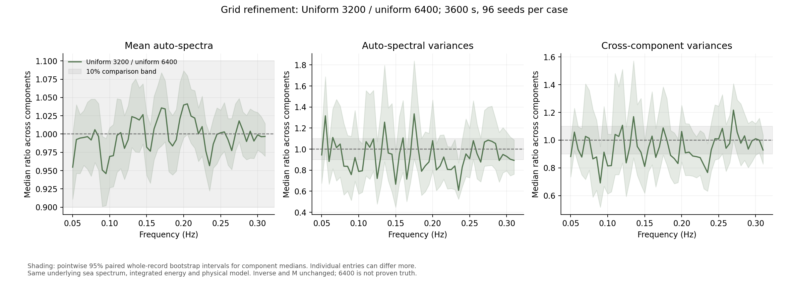
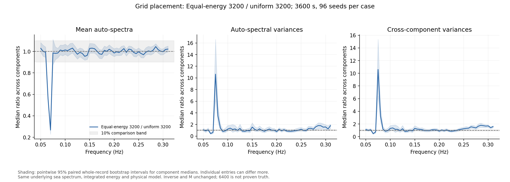

# Uniform wave-frequency grids before calibrating M

This compares two changes separately: moving 3200 wave components from
equal-energy bins to uniformly spaced frequency bins, then refining the uniform
grid from 3200 to 6400 components. The inverse and M are not fitted or changed.

**Result: uniform placement greatly reduces the earlier edge effects. The
remaining variance comparison is much closer, but full frequency-by-frequency
agreement within 10% is not established.** Uniform 6400 is a useful working
reference for the next check, not a validated production setting.

## Findings

For the uniform 3200 / uniform 6400 comparison:

- At 900 seconds, the whole-band median auto-spectral variance ratio is
  1.011 (95% bootstrap interval 0.953--1.068); the cross-component variance
  ratio is 1.024 (0.970--1.064). Both aggregate intervals lie inside the
  10% band. Some sub-bands and most individual variance intervals remain
  inconclusive. This duration is close to main's default 1200-second
  simulation after the initial 300-second discard.
- At 1800 seconds, the corresponding ratios are 1.007 (0.954--1.061) and
  1.006 (0.963--1.047), also inside the band at this aggregate level.
- At 3600 seconds, the auto-spectral variance ratio is 0.940 (0.892--0.974).
  The point estimate is about 6% lower at 3200, but the interval extends to
  10.8% lower. This narrowly misses aggregate equivalence within 10%; the
  interval also excludes one, so the remaining effect cannot simply be
  dismissed as sampling noise. The cross-component ratio is 0.945
  (0.910--0.981), inside the aggregate comparison band.
- Mean spectra agree much more precisely: at 3600 seconds the whole-band
  median ratio is 0.997 (0.991--1.006). Of 477 individual auto-spectral mean
  comparisons, 456 have intervals wholly inside the 10% band and none are
  wholly outside it. The other 21 remain inconclusive.

Placement matters even at the same frequency count. At 3600 seconds the
equal-energy 3200 / uniform 3200 mean ratio at 0.07 Hz is only 0.267;
the uniform 3200 / uniform 6400 ratio there is 0.996. In the 0.26--0.31 Hz
tail, equal-energy 3200 has 1.332 (1.230--1.499) times the auto-spectral
variance of uniform 3200, and 1.538 (1.443--1.635) times its cross-component
variance. This supports the concern about sparse edge coverage in the
equal-energy representation.

The remaining uniform-grid variance intervals are still broad at individual
frequencies. For the hour-long recordings, only 3 of 477 individual
auto-spectral variance intervals lie wholly inside the 10% band; 9 lie
wholly outside, and 465 overlap a boundary. These are descriptive pointwise
counts, not simultaneous confidence statements. Good aggregate agreement
does not certify every channel and frequency.

## Next step toward M

Use uniform 6400 as a candidate reference and improve the precision of the
paired variance comparison on fresh seeds, focusing on the actual intended
recording duration. Keep the hour-long result as a stress test rather than
silently extending the 900-second finding to it. If a material grid effect
remains after narrowing Monte Carlo uncertainty, compare against a finer
uniform grid before freezing the generator.

Only then calibrate the actual variance formulas used by the inverse, with
calibration and held-out evaluation records separated. This experiment does
not choose M = 2.5, another scalar M or M(f), and does not test inverse
recovery or posterior coverage.

## Controlled comparison

There are 96 seeds (104000--104095) per case and usable recording lengths of
900, 1800 and 3600 seconds. The three lengths are nested prefixes of the same
preprocessed long recording. The earlier equal-energy 3200 records are reused
with hashes; the two uniform cases require 192 new full simulations. Altogether
there are 864 spectral records, not 864 independent realisations.

The underlying JONSWAP spectrum, directional weights and total generated wave
energy are preserved. Uniform bin edges span the original 0.1--2 rad/s range
(approximately 0.0159--0.3183 Hz). Frequencies are at the bin centres. Each
bin receives the energy obtained by integrating the same 5000-point JONSWAP
CDF used by main; its stored spectral density is the bin-average density.
This avoids removing the low-energy tails or changing the total energy.
Spacing is approximately 0.0000945 Hz at 3200 and 0.0000472 Hz at 6400.

The 90 m hull, radius 5.36 m, depth 15 m, controller, nonlinear drag, radiation
memory, sensor errors and preprocessing remain those of main at
`caaaf415dbe7bd372187758fe542c69999913d3e`. Hs = 1.7 m, Tp = 8 s,
gamma = 3.3, spreading s = 10, direction pi/2, zero speed and 36 generation
directions are fixed. The BEM response grid remains at 40 frequencies.
The initial 300 seconds are discarded. Welch still uses 200-second Hann
segments at 2 Hz with 50% overlap; analysis retains 0.05--0.31 Hz.

The protocol, source fingerprint and grid/projection function hashes are saved
before the new records are generated. Seed labels are paired between cases;
changing the grid does not preserve identical realised waves. These are
resolution diagnostics, not held-out calibration or inverse validation data.

## What is checked

We compare the mean auto-spectra, the variances of all nine auto-spectra, and
the variances of all 72 real/imaginary cross-spectral components. The original
10% comparison band is retained. There are 1000 paired whole-record bootstrap
draws, preserving channel, frequency and record-length relationships.

`uniform_summary.csv` gives whole-band and four sub-band comparisons, including
95% intervals and the proportions of individual intervals wholly inside or
outside the 10% band. Overlap with a boundary means the comparison is
inconclusive. `uniform_frequencies.csv` contains individual entries.

The `equal3200 / 3200` rows compare equal-energy with uniform placement at the
same component count. The `3200 / 6400` rows test uniform-grid refinement.
The plotted curves take medians across components at each frequency; neither
those medians nor a whole-band median establish agreement for every entry.





## Numerical checks and limits

Tests verify total energy, phase and directional-weight preservation and
compare the uniform harmonic sums with direct sums across a full recording.
The runner also checks forcing and pressure values against the original
equations. Uniform sums use [SciPy ZoomFFT](https://docs.scipy.org/doc/scipy/reference/generated/scipy.signal.ZoomFFT.html)
to evaluate the same harmonic sum efficiently; it does not add wave components
or change the physical model.

Force checks scale each component by its harmonic RMS, with normalised
absolute tolerance 1e-10 and relative tolerance 2e-10. This avoids overstating
roundoff when instantaneous forces or torques cancel. Three seeds initially
flagged by the earlier instantaneous-value tolerance were rerun under this
checked scaling; no seed was dropped and the synthesis calculation was
unchanged. Twelve automated tests pass, including rejection of materially
perturbed forces and comparison against direct full-record harmonic sums.

The finest grid is a comparison reference, not proven continuum truth.
Bootstrap intervals are conditional on this sea, hull and noise model; they
are pointwise rather than simultaneous guarantees over the full spectrum.
Small observed differences with wide intervals do not establish agreement.
These are newly generated simulations, not the Drive ZIP or sea-trial data.
Numerical agreement would not validate the 40-frequency BEM grid, model
discrepancy, posterior coverage, M = 2.5, or a proposed M(f).

## Reproduce

Use the environment recorded in `convergence_environment.json`. The earlier
`variance_output/resolution` records and hydrodynamic cache must exist first
(see `variance_resolution.md`). From the repository root:

```sh
python WM/variance_uniform.py --workers 2
python WM/analyse_variance_uniform.py
python -m unittest discover -s WM -p test_spectral_variance.py -v
```

Raw checkpoints, reuse hashes and the hydrodynamic cache stay under the ignored
`variance_output/uniform` directory. Completed seeds are retained on restart.
The report and production source files remain unchanged.
